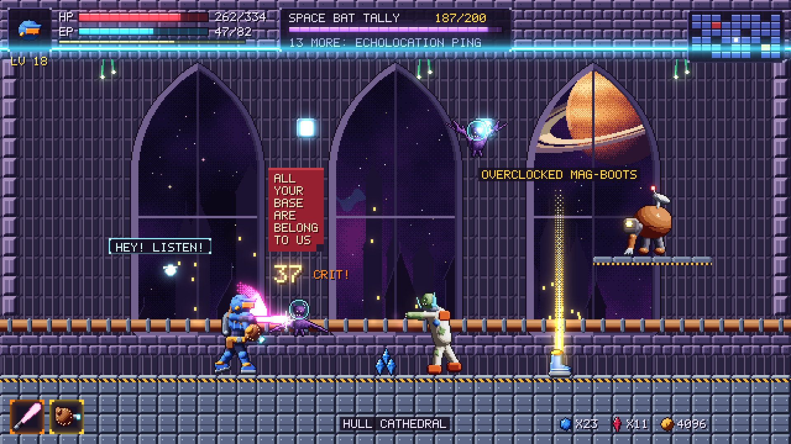
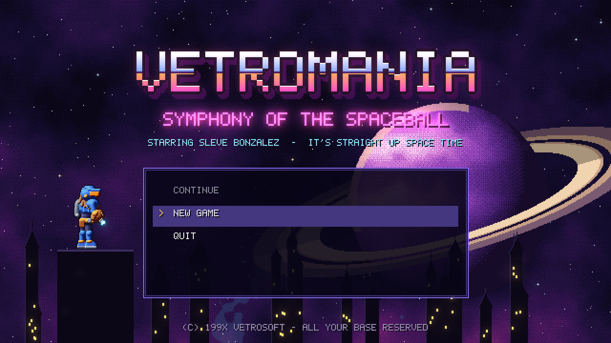
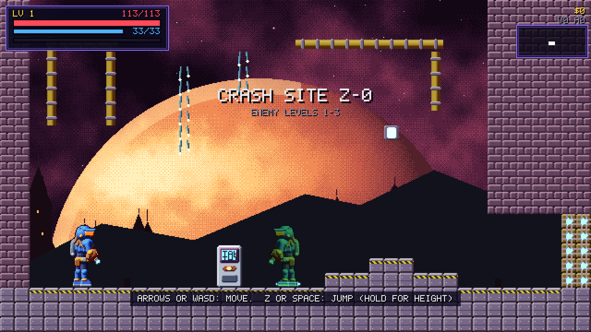
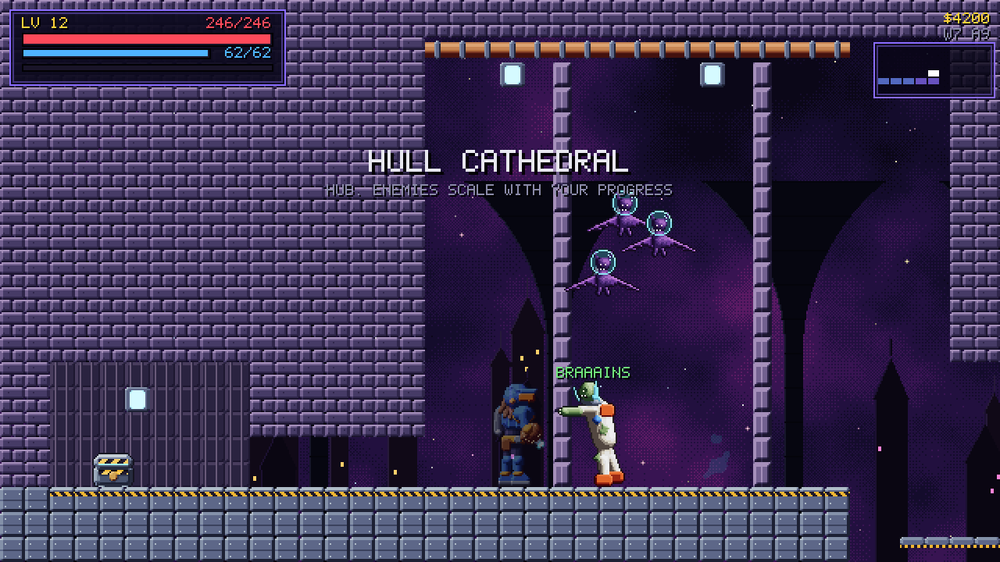
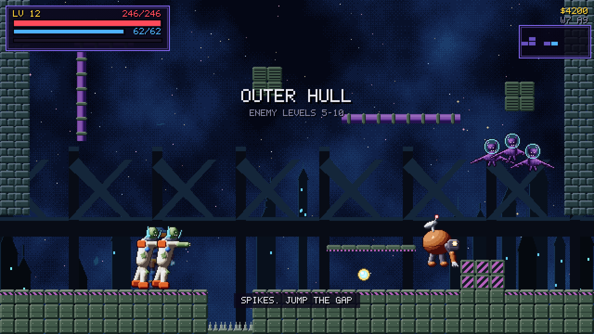
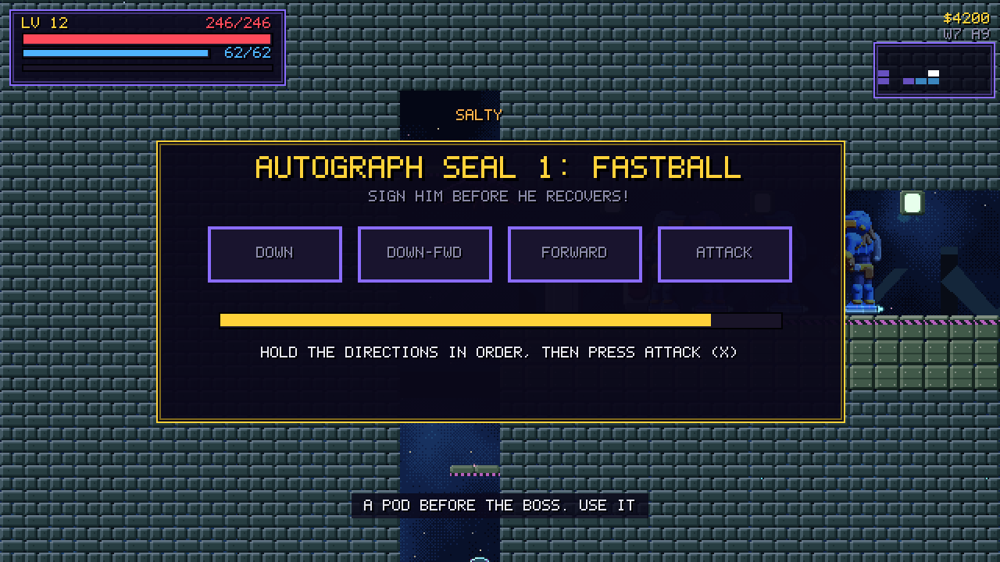
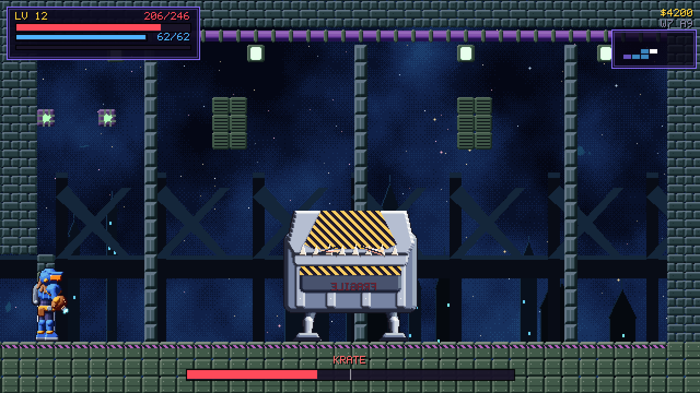
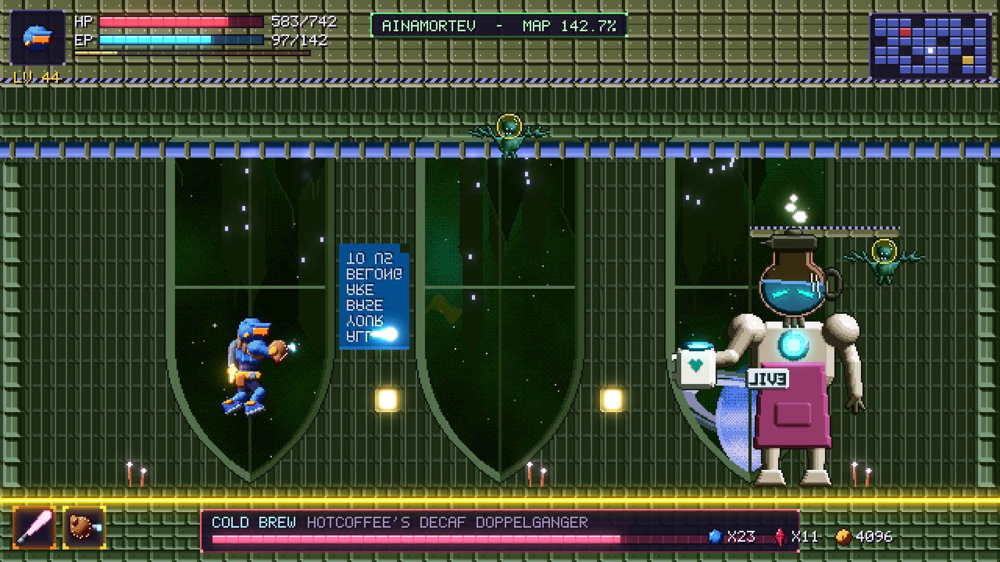
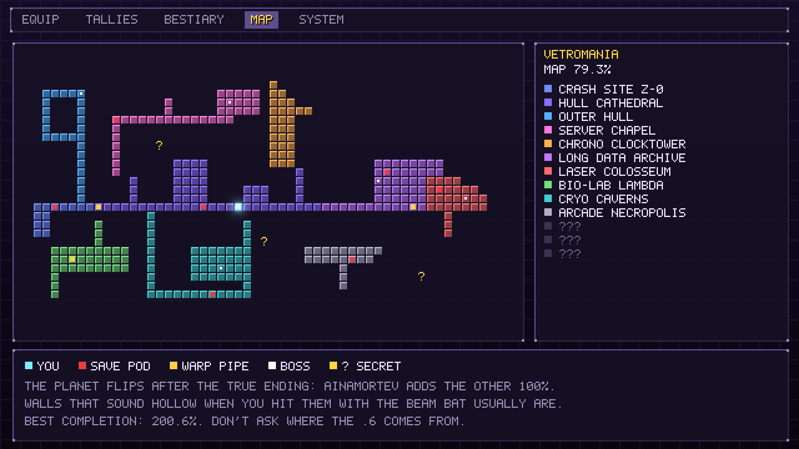

# VetroMania: Symphony of the Spaceball

*A 2D sci-fi Metroidvania with Dawn of Sorrow's feel, Diablo's loot, and a
200.6% map, wrapped in a planet-sized bit about 90s video games.*



Space bounty hunter **Sleve Bonzalez** crash-lands on the gothic glass planet
**VetroMania** to recover his favorite spaceball card, a 1994 holo-foil Bobson
Dugnutt rookie, from **HotCoffee**, an evil android barista with a
completionist streak. Get the true ending and the planet flips over into
**Ainamortev**, its upside-down mirror. Exploring every inch tops out at
**200.6%**.

This repository holds the **implementation plan**, the **concept assets**, and
a playable **vertical slice** of the game (Phase 1), built in Godot 4.7. Crash
on Crash Site Z-0, work through Hull Cathedral, climb the Outer Hull, and
finish **KRATE** with an Autograph Seal. See [Play the slice](#play-the-slice).

| | | |
| --- | --- | --- |
|  |  |  |
|  |  |  |

*These are real screenshots of the slice at its native 640x360.* More are in
[`docs/screens/`](docs/screens).

## Play the slice

You need the standard (non-.NET) build of [Godot 4.7](https://godotengine.org/download).

```sh
git clone https://github.com/zeigotaro/VetroMania.git
godot --path game          # or open game/project.godot in the editor and press F5
```

The game opens on the title screen. Pick a slot and a difficulty, then follow
the hints that pop up along the way.

| Action | Keyboard | Gamepad |
| --- | --- | --- |
| Move | Arrow keys or WASD | D-pad or left stick |
| Jump (hold for height) | Z or Space | A |
| Attack | X or J | X |
| Sub-weapon (hold to charge) | C or K | Y |
| Backdash | Shift | LB |
| Knack | V | RB |
| Interact (talk, save pods, chests, warp pipes) | Up | Up |
| Slide | Down + Jump | Down + Jump |
| Spaceball (once you find it) | Double-tap Down | Double-tap Down |
| Map | M | Back |
| Pause, equipment, and options | Esc | Start |
| Menus | Arrows, Z to select, X to go back, PgUp and PgDn for tabs | D-pad, A, B, LB and RB |

Autograph Seals are fighting-game motions. Hold the directions in order, then
press Attack. If that's not your idea of fun, turn on **Seal Assist** in
Pause, SYSTEM, which also has music and sound volume, screen shake, damage
numbers, game speed, and fullscreen.

Saves and settings live in Godot's user data folder for the project. On
Windows that's `%APPDATA%\Godot\app_userdata\VetroMania- Symphony of the Spaceball`.

**In the slice:** 11 rooms in 13 cells across three areas, three enemy types
and the KRATE boss, the Beam Bat, Mitt Cannon, Spaceball, Wall Kick, and
Jetpack, gear from common to legendary with gem upgrades at save pods, Kill
Tallies, stat points from Training Montages, three save slots, and four
secrets. What isn't built yet is listed in the
[implementation status](docs/implementation-plan.md#12-implementation-status).

## Highlights

*This is the full design. The slice builds a
[subset](docs/implementation-plan.md#12-implementation-status) of it.*

- **Dawn of Sorrow feel.** Snappy movement, a backdash that's always
  available, damage numbers, and **Autograph Seals**: fighting-game motion
  inputs that finish every boss.
- **Metroid-style ability gating.** Spaceball, Wall Kick, Jetpack, Plasma
  Whip, Curveball Bombs, Thermos Suit, Aqua-Mullet ("business in the front,
  gills in the back"), Blast Processing, Screwball Attack, Grav-Cleats, and the
  Holy Shades. A planned reachability solver checks every layout for
  softlocks.
- **The Flip.** Beat HotCoffee while wearing the Holy Shades and the planet
  turns upside down: 13 remixed areas, palette-swapped mirror enemies, and 13
  harder bosses. The true final boss is **COLD BREW**, HotCoffee's decaf
  doppelganger.
- **RPG leveling** to Lv 50, with a Training Montage every 5 levels.
- **Kill Tallies.** Kill 200 of an enemy type (100 for elite types, 25 for
  rare spawns) and earn a perk related to it. Space Bats teach Echolocation
  Ping. Perks never bypass ability gates.
- **Diablo-style leveled loot.** Five rarities, affixes, sets, and legendary
  powers. Six armor slots plus two rings (slot 1 opens at Lv 20, slot 2 at
  Lv 37, and no rings drop before Lv 20). Gem upgrades are capped by level
  band (+1 to +5), and gems drop in white, blue, and ruby packs of 1, 3, and
  5.
- **Crammed with references.** 120 of them in a ledger, each with its
  placement and a legal-risk tag. Parody only, never copies.

## Gallery

These are the **concept** renders that set the target. The slice's own
screenshots are at the top of this page.

| Title screen | Ainamortev, the flipped planet |
| --- | --- |
|  |  |
| **Equipment** | **World map** |
|  |  |

| Sleve runs | Sleve swings | Spaceball | Space Bat | HotCoffee |
| --- | --- | --- | --- | --- |
|  |  |  |  |  |


More in [Art direction](docs/art/art-direction.md#concept-gallery) and in
[`assets/concept/`](assets/concept).

## Documents

| Document | What's in it |
| --- | --- |
| [Implementation plan](docs/implementation-plan.md) | Vision, pillars, influences, requirements traceability, content budget, team, phases, risks, and gap decisions |
| [Story and tone](docs/design/story-and-tone.md) | Premise, cast, story beats, both endings, and the humor guardrails |
| [The Roster](docs/design/roster.md) | The 22 fake baseball names we keep, their source, and the rules for using them |
| [World and map](docs/design/world-and-map.md) | The 13 areas, the gating matrix, the critical path, the Flip, 200.6%, and the slice's layout |
| [Player and combat](docs/design/player-and-combat.md) | Controls, movement numbers, abilities, weapons, damage formulas, bosses, and seals |
| [Progression and loot](docs/design/progression-and-loot.md) | XP curve, stats, gear slots, rings, affixes, drops, Loot Luck, upgrades, and gems |
| [Bestiary](docs/design/bestiary.md) | 90 tallies, 40 base enemies and their perks, mirror variants, and 27 bosses |
| [Reference ledger](docs/design/reference-ledger.md) | 120 references and memes, with where they appear and their risk |
| [Technical architecture](docs/technical/architecture.md) | Godot 4, how the slice is built and where it differs from the plan, the data model, the loot generator and simulator, the Flip pipeline, the solver, saves, and CI |
| [Level format](docs/technical/level-format.md) | The room JSON files, the tile legend, entities, and the linter's rules |
| [Art direction](docs/art/art-direction.md) | Resolution, sprite specs, shading rules, palettes, animation budgets, and the gallery |

## Repository layout

```text
game/               the Godot 4.7 project: the playable vertical slice
docs/               the plan, the design documents, and screenshots
tools/              godot.py (test runner), level_tools.py, game_assets/, concept_art/
assets/concept/     procedural concept art (PNG sheets, GIFs, and mockups)
.github/workflows/  CI
```

## Develop

Python 3.12 and Godot 4.7 (put it on `PATH`, or set `GODOT`). The Python tools
need Pillow and NumPy for the art and audio generators only:

```sh
python -m pip install -r tools/concept_art/requirements.txt

python tools/godot.py test           # import, compile every script, run all 16 suites (about 20 s)
python tools/godot.py smoke          # play the whole slice through the real UI, headless
python tools/godot.py shots          # windowed screenshot tour (needs a display and a GPU)
python tools/level_tools.py lint     # check every room; "preview" draws one to a PNG
python tools/game_assets/export.py   # regenerate game/assets (add --check to verify)
python tools/game_assets/audio.py    # regenerate game/assets/audio (add --check to verify)
python tools/godot.py script res://tests/loot_sim.gd -- --kills=200000 --level=20
```

CI runs the same checks on every pull request. The
[architecture doc](docs/technical/architecture.md#vertical-slice-as-built)
explains how the game and its tests fit together, and the
[level format](docs/technical/level-format.md) explains how to build a room.

## Regenerating the concept art

Every image is rendered by code, not painted, so it can be rebuilt
deterministically:

```sh
python -m pip install -r tools/concept_art/requirements.txt
python tools/concept_art/generate.py
```

See the [toolkit README](tools/concept_art/README.md) for details.

---

*VetroMania is a parody and homage. All referenced games, characters, and
trademarks belong to their respective owners. See the
[reference ledger](docs/design/reference-ledger.md) for how each reference is
handled.*
