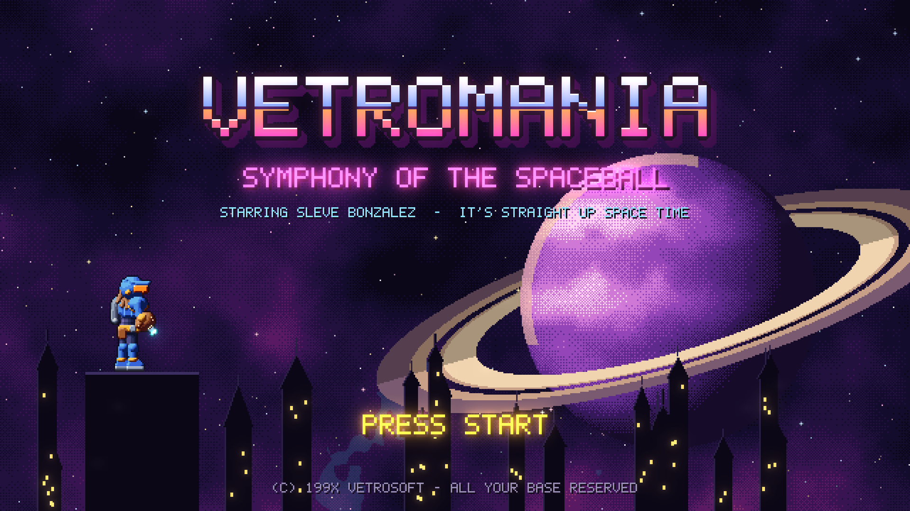
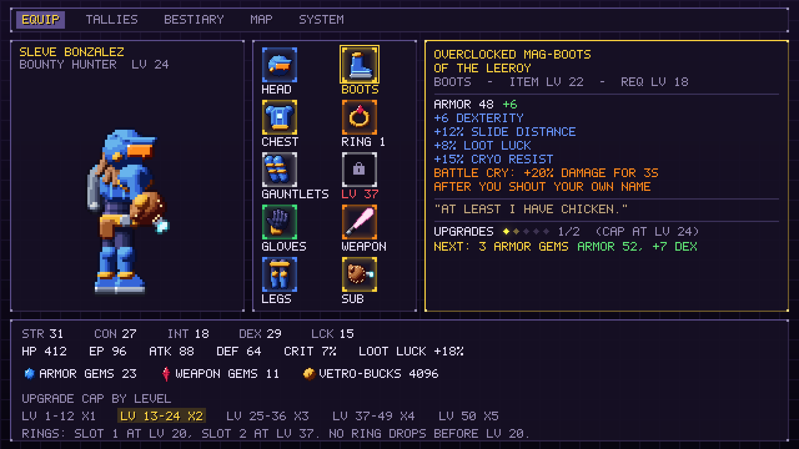
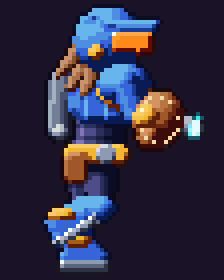
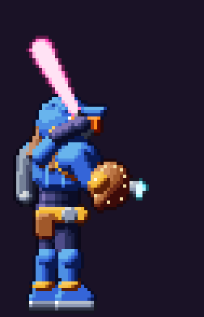
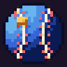
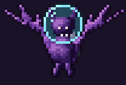
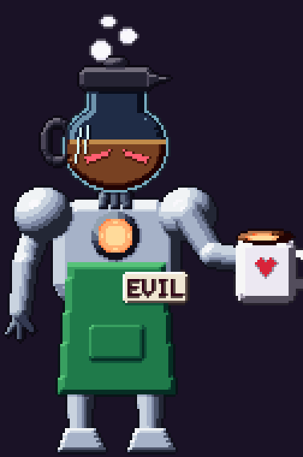
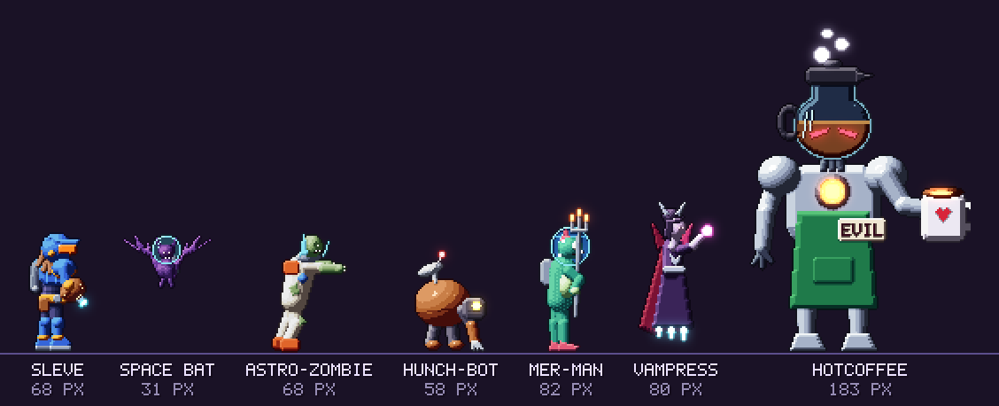

# VetroMania: Symphony of the Spaceball

*A 2D sci-fi Metroidvania with Dawn of Sorrow's feel, Diablo's loot, and a
200.6% map, wrapped in a planet-sized bit about 90s video games.*


Space bounty hunter **Sleve Bonzalez** crash-lands on the gothic glass planet
**VetroMania** to recover his favorite spaceball card, a 1994 holo-foil Bobson
Dugnutt rookie, from **HotCoffee**, an evil android barista with a
completionist streak. Get the true ending and the planet flips over into
**Ainamortev**, its upside-down mirror. Exploring every inch tops out at
**200.6%**.

This repository holds the **implementation plan** and **concept assets**.
Game code starts in Phase 0 (see the
[production plan](docs/implementation-plan.md#8-production-plan)).

## Highlights

- **Dawn of Sorrow feel.** Snappy movement, a backdash that's always
  available, damage numbers, and **Autograph Seals**: fighting-game motion
  inputs that finish every boss.
- **Metroid-style ability gating.** Spaceball, Wall Kick, Jetpack, Plasma
  Whip, Curveball Bombs, Thermos Suit, Aqua-Mullet ("business in the front,
  gills in the back"), Blast Processing, Screwball Attack, Grav-Cleats, and the
  Holy Shades. A planned reachability solver checks every layout for
  softlocks.
- **The Flip.** Beat HotCoffee while wearing the Holy Shades and the planet
  turns upside down: 13 remixed areas, palette-swapped mirror enemies, and 13
  harder bosses. The true final boss is **COLD BREW**, HotCoffee's decaf
  doppelganger.
- **RPG leveling** to Lv 50, with a Training Montage every 5 levels.
- **Kill Tallies.** Kill 200 of an enemy type (100 for elite types, 25 for
  rare spawns) and earn a perk related to it. Space Bats teach Echolocation
  Ping. Perks never bypass ability gates.
- **Diablo-style leveled loot.** Five rarities, affixes, sets, and legendary
  powers. Six armor slots plus two rings (slot 1 opens at Lv 20, slot 2 at
  Lv 37, and no rings drop before Lv 20). Gem upgrades are capped by level
  band (+1 to +5), and gems drop in white, blue, and ruby packs of 1, 3, and
  5.
- **Crammed with references.** 120 of them in a ledger, each with its
  placement and a legal-risk tag. Parody only, never copies.

## Gallery

| Title screen | Ainamortev, the flipped planet |
| --- | --- |
|  |  |
| **Equipment** | **World map** |
|  |  |

| Sleve runs | Sleve swings | Spaceball | Space Bat | HotCoffee |
| --- | --- | --- | --- | --- |
|  |  |  |  |  |



More in [Art direction](docs/art/art-direction.md#concept-gallery) and in
[`assets/concept/`](assets/concept).

## Documents

| Document | What's in it |
| --- | --- |
| [Implementation plan](docs/implementation-plan.md) | Vision, pillars, influences, requirements traceability, content budget, team, phases, risks, and gap decisions |
| [Story and tone](docs/design/story-and-tone.md) | Premise, cast, story beats, both endings, and the humor guardrails |
| [World and map](docs/design/world-and-map.md) | The 13 areas, the gating matrix, the critical path, the Flip, and 200.6% |
| [Player and combat](docs/design/player-and-combat.md) | Controls, movement numbers, abilities, weapons, damage formulas, bosses, and seals |
| [Progression and loot](docs/design/progression-and-loot.md) | XP curve, stats, gear slots, rings, affixes, drops, Loot Luck, upgrades, and gems |
| [Bestiary](docs/design/bestiary.md) | 90 tallies, 40 base enemies and their perks, mirror variants, and 27 bosses |
| [Reference ledger](docs/design/reference-ledger.md) | 120 references and memes, with where they appear and their risk |
| [Technical architecture](docs/technical/architecture.md) | Godot 4, the data model, the loot generator and simulator, the Flip pipeline, the solver, saves, and CI |
| [Art direction](docs/art/art-direction.md) | Resolution, sprite specs, shading rules, palettes, animation budgets, and the gallery |

## Repository layout

```text
assets/concept/     procedural concept art (PNG sheets, GIFs, and mockups)
docs/               the plan and the design documents
tools/concept_art/  the Python generator for everything in assets/concept/
```

## Regenerating the concept art

Every image is rendered by code, not painted, so it can be rebuilt
deterministically:

```sh
python -m pip install -r tools/concept_art/requirements.txt
python tools/concept_art/generate.py
```

See the [toolkit README](tools/concept_art/README.md) for details.

---

*VetroMania is a parody and homage. All referenced games, characters, and
trademarks belong to their respective owners. See the
[reference ledger](docs/design/reference-ledger.md) for how each reference is
handled.*
