# Art Direction

[Back to the implementation plan](../implementation-plan.md)

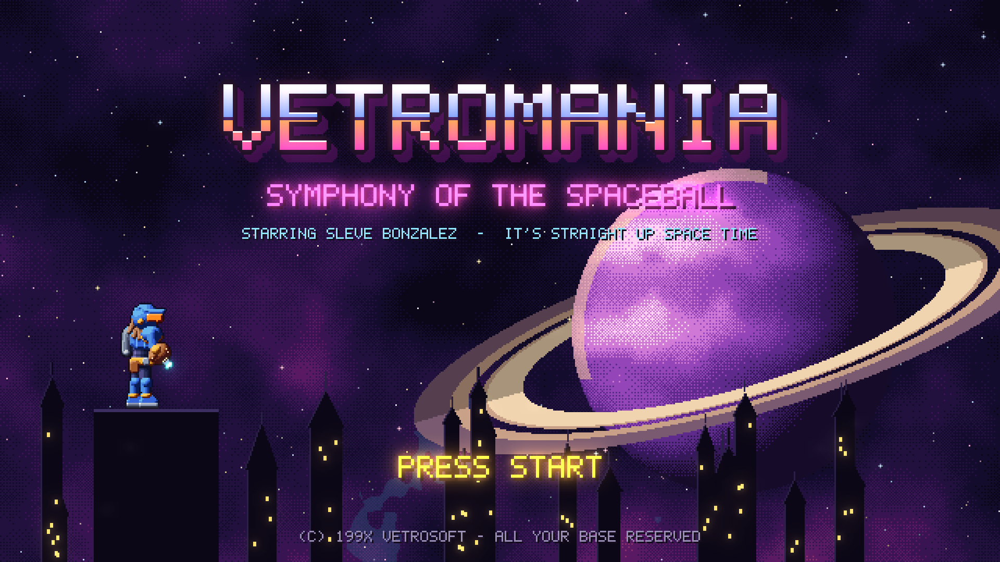

## The target

The proposal asks for graphics **one to two generations after the Nintendo
DS**: the 3DS-to-Switch era. We read that as **HD pixel art**. The pixel
density is well past the DS, but the look is still hand-placed pixels, with
modern light, bloom, and parallax layered on top. Think Bloodstained's
gothic color and readability, delivered in sprites instead of 3D models.

All concept art in this repository is procedural; see
[the toolkit](../../tools/concept_art/README.md). It locks **scale, palette,
shading rules, and tone**. Production art is hand-drawn to the same rules.

## Resolution and scale

- **Native 640x360**, integer-scaled to 720p, 1080p, 1440p, and 4K. That's
  2.5x the horizontal resolution of a DS screen (256x192).
- **Tiles are 16x16.** A map cell is 40 x 23 tiles.
- **Sleve is 68 px tall**, about 19% of the screen height. That leaves room
  to read a whole room while keeping him detailed enough for gear and
  animation.

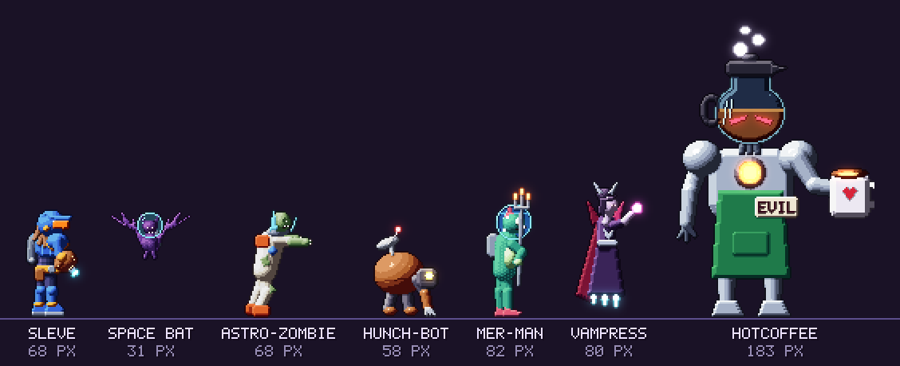

| Asset | Size | Notes |
| --- | --- | --- |
| Sleve | 68 px tall (the frame canvas is 96 x 100) | Pivot at the feet. The 31 px of headroom above him is for raised weapons: the wind-up bat reaches y = 3 |
| Small enemies | 24–40 px | The Space Bat is 31 px |
| Standard enemies | 55–85 px | Astro-Zombie 68, Hunch-Bot 58, Mer-Man 82, Vampress 80 |
| Bosses | 150–250 px | HotCoffee is 183 px on a 156 x 200 canvas |
| Tiles | 16 x 16 | Seamless, with no outlines or contact shadows |
| Props | Multiples of 16 | The gothic window is 32 x 48 |
| Item icons | 24 x 24, inside 28 x 28 rarity frames | Readable at 1x in the inventory list |
| UI font | 5 x 7 glyphs on a 6 px advance | Uppercase only. 2x and 3x for headings |

## Shading rules

These are exactly what the concept renderer does, and production art follows
them by hand:

1. **One key light from the top left.** Surfaces facing it are banded into
   4–6 steps per material.
2. **Hue-shifted ramps.** Shadows drift toward blue-violet and gain
   saturation. Highlights drift toward warm yellow and lose saturation. No
   gray shadows.
3. **Contact shadows.** Where a front part overlaps a back part, the back
   part's pixels next to the edge drop one step. This is what makes limbs
   read.
4. **Selective outlines.** Each material outlines itself in its darkest
   ramp color, pushed toward ink (`#140c1c`). Never pure black.
5. **Specular only on hard materials.** Armor, chrome, glass, and gems. One
   to three pixels, never a smear.
6. **Rim light in dark rooms.** A thin right-side rim separates characters
   from dark backgrounds.
7. **Emission means something.** Only energy weapons, eyes, lights,
   interactables, and loot glow, and every glowing pixel feeds the bloom. If
   it glows, it matters.

## Palette

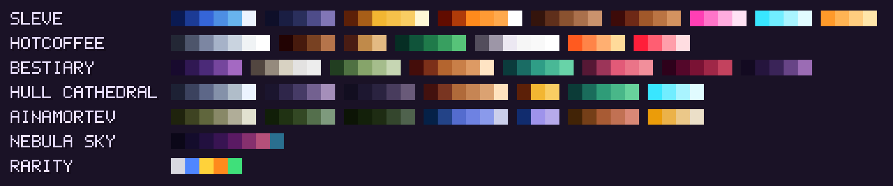

| Family | Anchor colors |
| --- | --- |
| Sleve | Royal-blue armor `#3565d8`, amber visor `#ff8a1c`, gold trim `#f2b632`, mullet `#8a5230`, catcher's-mitt leather `#a0582a`, magenta Beam Bat `#ff3fb4`, cyan Mitt Cannon muzzle `#39e6ff` |
| HotCoffee | Chrome `#95a1bd`, coffee `#5a2c14`, crema `#c08a4a`, barista apron `#1f7a4a`, ceramic mug `#ece8f2`, warming-plate core `#ff5a1f`, red eyes `#ff1f3a` |
| Hull Cathedral | Steel `#5d6788`, stone `#463b66`, back wall `#2a2340`, copper pipes `#b06a3a`, hazard `#f2b632`, vines `#2f9c78`, conduits `#39e6ff` |
| Nebula sky | `#0b0718` → `#140c2c` → `#22103f` → `#381452` → `#5a1a63` → `#86306e` → `#b5507a`, with a `#2a6f8f` accent |
| UI | Panel `#161024`, edge `#5c4e8c`, text `#ece6ff`, dim text `#968cb4`, ink `#140c1c` |
| Rarity | Common `#d8d8e0`, magic `#4f86ff`, rare `#ffd23a`, legendary `#ff8a1c`, set `#3fe07a` |

**Readability rules:**

- **Separate foreground from background by value.** Backgrounds stay below
  about 40% value, and less saturated than anything you can touch.
- **Hostile projectiles are hot and saturated** (magenta, orange, or red).
  Sleve's own effects are cyan and magenta. Nothing in a background uses a
  projectile color at full saturation.
- **Dithering** (4x4 Bayer) is for sky gradients and large glows only, never
  on characters.
- **Sprites face right** in source files; the engine flips them.

## Animation budgets

Frame counts for production. Timings are at 60 Hz.

| Sleve | Frames | Notes |
| --- | --- | --- |
| Idle / long idle | 6 / 16 | The long idle taps a foot, checks the card, and sighs |
| Run | 10 | The concept has 8 at 90 ms |
| Jump (rise, apex, fall, land) | 2 + 2 + 2 + 2 | |
| Double jump, wall kick, slide, backdash | 4, 3, 3, 3 | |
| Attacks | 5–8 per weapon class | The Beam Bat chain is 5 + 5 + 7 |
| Sub-weapon, taunt | 4, 6 | |
| Hurt, death | 2, 10 | |
| Spaceball, swim, grapple, ceiling walk | 8, 8, 4, 8 | |
| Seal finish | 12 | A signature flourish |

| Everyone else | Total frames |
| --- | --- |
| Fodder | 12–20 |
| Sturdy | 20–30 |
| Elite type | 30–45 |
| Boss | 120–250, with every attack wind-up held for at least 12 frames |

**Gear visibility (a gap decision).** Armor doesn't change Sleve's sprite,
because redrawing every piece on every frame would multiply the animation
budget. What does show: the equipped **weapon class**, a **palette tint for
full sets**, and a chrome glint on **+5** items. The equipment screen's
paper doll does show gear.

## Environments

- **Hull Cathedral is the style anchor:** gothic arch windows onto the
  starfield, riveted steel floors, glowing conduits, grates, and vines.
- **Every area gets a unique tile set, a parallax set, a map color, and a
  prop kit.** Area palettes may share materials but never share a dominant
  hue.
- **Background gags** (posters, graffiti, screens) are limited to one per
  room, as the [tone bible](../design/story-and-tone.md#density) requires.

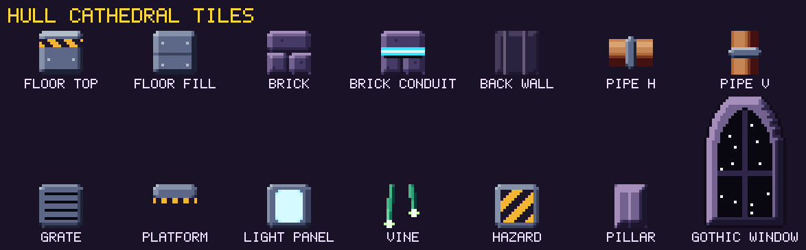

## Ainamortev treatment

Everything is flipped vertically. Environments are hue-rotated (a turn of
0.42 in YIQ space) and dimmed to 92% brightness, and the sky gets a new
nebula. Enemies get individual hue turns, so the palette swaps read as
distinct. HotCoffee rotated half a turn becomes COLD BREW, with blue coffee.
In production, these are per-area color lookup tables (see
[Architecture](../technical/architecture.md#rendering)).

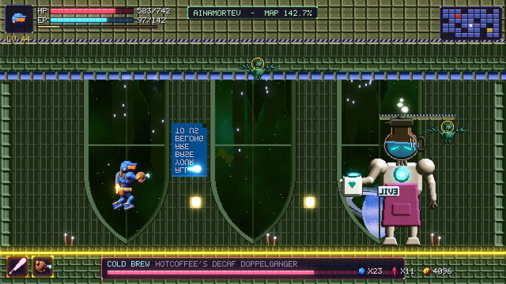

## UI

- **Panels:** a dark violet fill, a lit top-left edge, a darker bottom-right
  edge, and bright corner studs.
- **Bars:** segmented meters with a dark trough and a two-tone fill. HP is
  red, EP is cyan, and XP is gold.
- **Rarity** is shown by frame color **and** corner shape (see
  [Accessibility](../design/player-and-combat.md#accessibility)). The concept
  frames are color-only; production adds the shapes.
- **Toasts** (tallies, pickups) slide in at the top center and never cover
  Sleve.

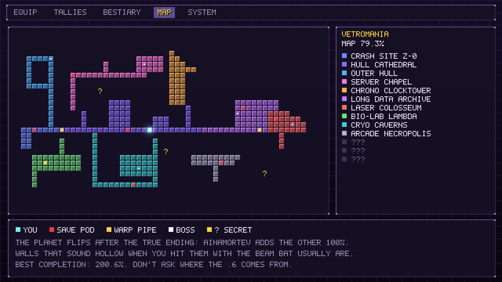

## Concept gallery

| | |
| --- | --- |
| 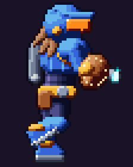 | 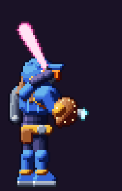 |
| 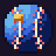 | 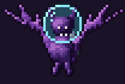 |
| 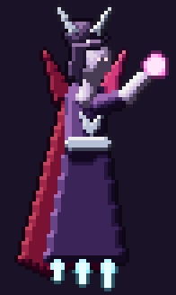 | 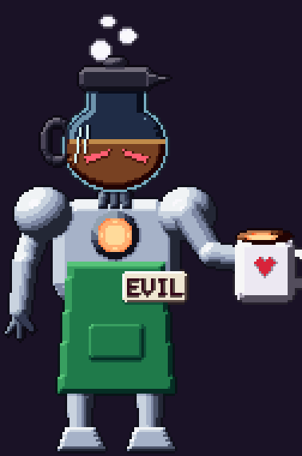 |
| 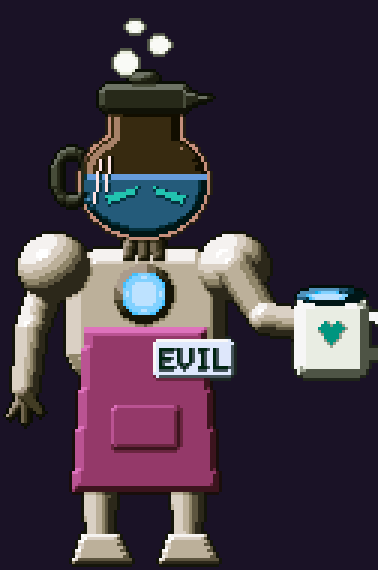 | 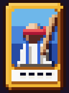 |

The full asset list, with sizes, is in the
[toolkit README](../../tools/concept_art/README.md#output).

## From concept to production

1. The rules above are the brief. The concept assets are the reference for
   scale, palette, and value, not something to trace.
2. Production sprites are drawn in **Aseprite**, with a palette file per
   character and area. The palette lint in CI rejects stray colors.
3. Sleve and the bosses are built as **layered paper dolls** (body, arms,
   weapon, effects), mirroring the concept rig. Weapon classes swap one layer
   instead of redrawing Sleve.
4. Each milestone gets an art review against this document, in-engine at
   1x, 2x, and 3x on both a monitor and a Steam Deck.
