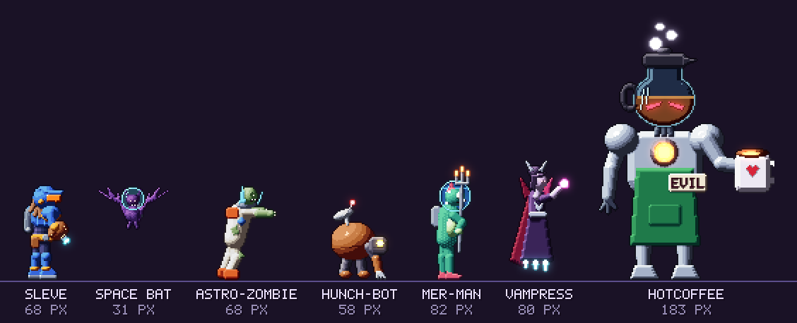
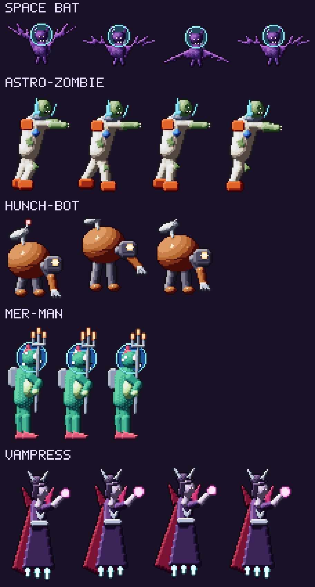
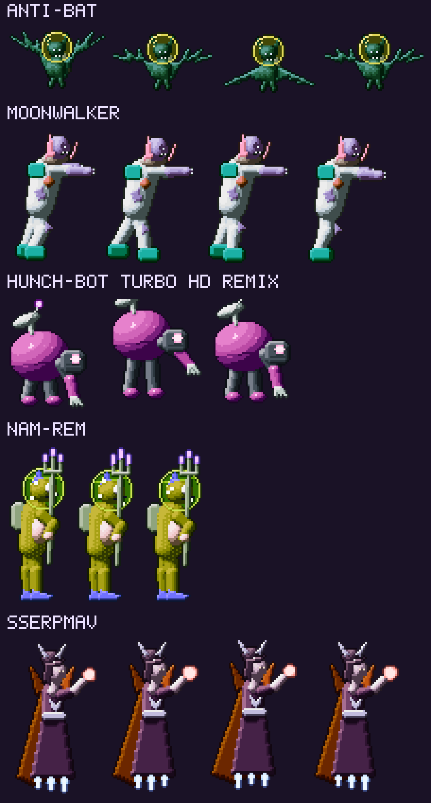
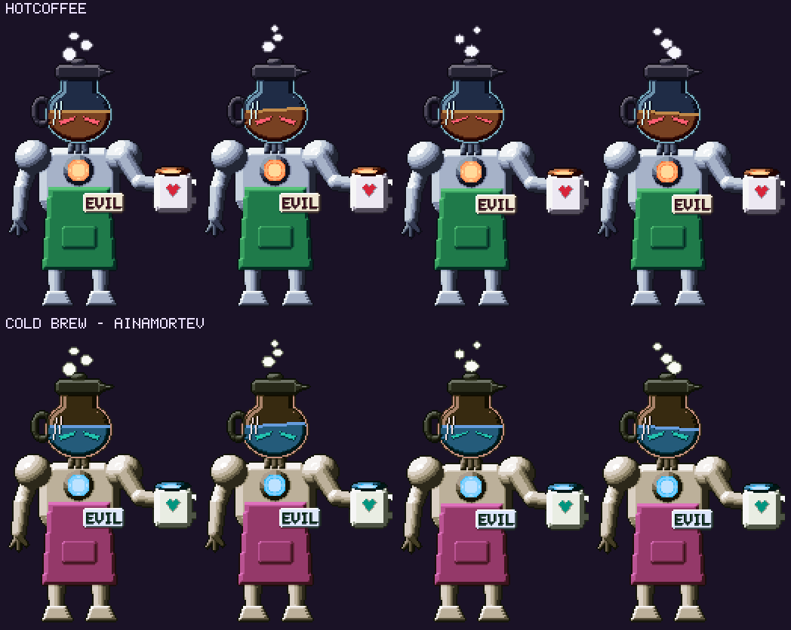

# Bestiary

[Back to the implementation plan](../implementation-plan.md)

## Design rules

1. **The lazy transposition.** Take a classic fantasy or Castlevania monster,
   add one sci-fi object, and commit to the bit. A bat in a fishbowl space
   helmet is a Space Bat. A hunchback whose hump is a satellite dish is a
   Hunch-Bot. The joke is that nobody tried very hard, so the art must try
   very hard.
2. **A readable silhouette first.** Every enemy must read in solid black at
   1x scale, facing either way.
3. **One job each.** Every enemy has one core behavior that teaches or tests
   one skill (jump timing, backdash, sub-weapon use, and so on).
4. **Tiers:**

   | Tier | HP base | Role | Tally threshold |
   | --- | --- | --- | --- |
   | Fodder | 50 | Room filler, often in groups | 200 |
   | Sturdy | 90 | A single threat that anchors a room | 200 |
   | Elite type | 150 | A mini-boss-lite with 2–3 attacks | 100 |
   | Rare spawn | 60 | Appears 1 time in 50; runs away or hides | 25 |

   Any enemy can also spawn as an **elite** version (+2 levels, x3 HP, and an
   elite affix). See [Player and combat](player-and-combat.md#enemy-scaling).

## Kill Tallies

Our take on Aria of Sorrow's enemy souls, made deterministic: every enemy type
keeps a kill count, and finishing the count earns a perk.

| Progress | Reward |
| --- | --- |
| First kill | Bestiary entry and 5x XP |
| 25% of the threshold | Weaknesses, resistances, and the drop table are revealed |
| 50% | **Rival:** that enemy type drops loot 25% more often for you |
| 100% | **The perk**, with a fanfare: "TALLY COMPLETE!" |

- **Perk types.** A **Trait** is always on: a small stat or utility boost. A
  **Knack** is an active or toggled power, equipped in a Knack slot and used
  with the Knack button. The first Knack slot is open from the start; the
  second opens after 10 completed tallies and the third after 30.
- **Mirror tallies** (Ainamortev variants) upgrade the original perk to its
  **EX** version. For example, *Echolocation Ping EX* reaches 2 screens.
- **What counts:** kills by Sleve, his sub-weapons, NAG-9000, and allies
  converted by *The Wololo*. Boss Rush kills don't count.
- **The hard rule: no perk grants traversal or opens a gate.** Reveal perks
  show things; they never break or open them. The reachability solver runs
  with every perk switched off.
- The HUD toast shows progress toward the next perk. The gameplay mockup
  shows "SPACE BAT TALLY 187/200 – 13 MORE: ECHOLOCATION PING".

## The featured five

These five have concept art, with idle loops in
[`assets/concept/enemies/`](../../assets/concept/enemies).

| Enemy | The bit | Behavior | Areas | Tier and tally | Perk |
| --- | --- | --- | --- | --- | --- |
| **Space Bat** | A bat in a fishbowl space helmet, for no reason | Sine-wave flight, then a dive when you're below it. Swarms of 3–5 | C, H, O | Fodder, 200 | **Echolocation Ping** (Knack): a ping that highlights breakable walls within 1 screen. It reveals them; it doesn't break them |
| **Astro-Zombie** | An astronaut zombie who never took his helmet off | Shambles, then lunges when you're within 3 tiles. Groans "BRAAAINS" over the suit radio | C, H, K | Fodder, 200 | **Braaains** (Trait): +2 INT |
| **Hunch-Bot** | A hunched robot whose hump is a satellite dish | Hops toward you in arcs and knuckle-walks; the dish tracks you | H, S, D | Fodder, 200 | **Satellite Uplink** (Knack): the minimap shows item locations in the current room |
| **Mer-Man** | A fish-man in a water-filled fishbowl helmet, with a scuba tank and trident | Leaps out of water in an arc and fires an eye laser on landing | K, D | Sturdy, 200 | **Fishbowl Lungs** (Trait): +15% damage while underwater |
| **Vampress** | A caped countess hovering on jet heels, holding an energy orb | Teleports between mirrors and fires orb volleys that drain EP | S, T, E | Elite type, 100 | **Energy Drain** (Trait): melee hits restore 1 extra EP |

## Full roster: Planet VetroMania

The featured five, plus 35 more, make 40 base enemies. The Area column uses
the [area codes](world-and-map.md#areas-of-planet-vetromania).

| # | Enemy | Transposed from | The bit | Areas | Tier and tally | Perk |
| --- | --- | --- | --- | --- | --- | --- |
| 6 | **Skele-Bot** | Skeleton | A robot endoskeleton that lost its skin. Throws bolts instead of bones | H, O, A | Fodder, 200 | **I'll Be Back** (Knack): once per save-pod visit, survive a lethal hit with 1 HP |
| 7 | **Duct-Tape Mummy** | Mummy | An astronaut wrapped in duct tape, "for repairs" | D, A | Sturdy, 200 | **Duct Tape Fixes Everything** (Trait): +15% from healing items |
| 8 | **Wear-Wolf** | Werewolf | A wolf wearing a spacesuit. That's it. That's the whole transformation | O, K | Sturdy, 200 | **Howl** (Knack, 10 EP): stuns nearby fodder for 1 s |
| 9 | **Ghost in the Machine** | Ghost | A CRT monitor haunted by its own screensaver | S, A | Fodder, 200 | **Screensaver** (Trait): +4 invulnerable frames on the backdash |
| 10 | **Gargle-oyle** | Gargoyle | A stone sentinel that spits mouthwash | H, T | Sturdy, 200 | **Minty Fresh** (Trait): +10% CRYO resist |
| 11 | **Medusa Headset** | Medusa head | VR headsets flying in sine waves, trailing snake cables | T, A | Fodder, 200 | **No Lag** (Trait): stuns and slows last 50% shorter |
| 12 | **Harpy Birthday** | Harpy | Party drones in feathered hats that sing at you | O, T | Fodder, 200 | **Party Favor** (Trait): +5% Vetro-Bucks |
| 13 | **Lo-Fi Golem** | Golem | A hulk built from old speakers and cassette tapes | D, M | Elite type, 100 | **Heavy Bass** (Trait): +25% knockback resistance |
| 14 | **Glitch Witch** | Witch | A witch on a hoverboard broom who hexes your HUD | S, V | Sturdy, 200 | **Hex Editor** (Trait): sub-weapon hits have a 10% chance to apply a random status |
| 15 | **Franken-Server** | Frankenstein's monster | A rack server stitched from spare parts, with neck bolts | S | Sturdy, 200 | **Bolt-On** (Trait): +10% VOLT resist |
| 16 | **Lizard-Man-ager** | Lizardman | A lizard in a business suit who wants those reports by Friday | D, V | Fodder, 200 | **Synergy** (Trait): +3% XP |
| 17 | **Slime-ba** | Slime | A robot vacuum that is also, somehow, a slime | B, K | Fodder, 200 | **Clean Sweep** (Trait): +50% pickup-magnet radius |
| 18 | **Imp-ulse Buyer** | Imp | A tiny devil with a shopping addiction | V, H | Fodder, 200 | **Coupon Clipper** (Trait): shop prices -5% |
| 19 | **Ban-She-Bot** | Banshee | A screaming smart speaker that answers to "Hey, Banshee" | S, T | Sturdy, 200 | **Noise Canceling** (Trait): immune to scream stuns |
| 20 | **Mine-otaur** | Minotaur | A bull in a miner's helmet that charges down tunnels | M | Elite type, 100 | **Bull Rush** (Trait): Blast Processing dashes deal +50% damage |
| 21 | **Cy-Clops** | Cyclops | A one-eyed security camera on legs | L, D | Sturdy, 200 | **Depth Perception** (Trait): +2% crit chance |
| 22 | **Headless Horse-Mech** | Dullahan | A mech horse whose rider carries his cockpit under one arm | L, E | Elite type, 100 | **Heads Up** (Trait): shows enemy HP bars |
| 23 | **Flea-Droid** | Fleaman | Tiny hopping bots that ride on Hunch-Bots | H, S | Fodder, 200 | **Itchy Trigger** (Trait): +5% attack speed |
| 24 | **Tax Armor** | Axe armor | A knight who throws spinning tax forms | T, E | Sturdy, 200 | **Write-Off** (Trait): items sell for +10% |
| 25 | **Spear-Phisher** | Spear guard | A guard who lunges with a spear and a suspicious link | D, V | Fodder, 200 | **Spam Filter** (Trait): +10% DEF against projectiles |
| 26 | **Man-Drag-Ora** | Mandragora | A potted plant that screams dial-up noise when disturbed | B | Fodder, 200 | **Handshake** (Trait): warp-pipe travel skips its animation |
| 27 | **Ecto-Plasma TV** | Ectoplasm | A floating plasma TV full of static | A, S | Fodder, 200 | **High Def** (Trait): +3% DEF |
| 28 | **Crunch-Time Devil** | Devil | A game-dev demon who hasn't slept since 1997 | E | Sturdy, 200 | **Crunch Time** (Knack): +10% damage for 10 s after leaving a save pod |
| 29 | **Cock-a-Trice** | Cockatrice | A rooster alarm clock whose crow shocks you awake | T | Sturdy, 200 | **Early Riser** (Trait): Shock and Frostbite last 50% shorter |
| 30 | **Cerber-USB** | Cerberus | A three-headed robo-dog with USB plugs for heads. It takes three tries to connect | A, L | Elite type, 100 | **Plug and Play** (Trait): your first hit in each room deals +25% |
| 31 | **Wi-Fi Wight** | Wight | A wraith that drains your signal bars | S, V | Sturdy, 200 | **Full Bars** (Trait): +10% EP regeneration |
| 32 | **Pollster-geist** | Poltergeist | Throws furniture, then asks you to rate the experience | H, D | Fodder, 200 | **Survey Says** (Knack): the map marks explored rooms that still hold chests |
| 33 | **Stack Overflow Pillar** | Bone pillar | A stack of skulls that spits fireballs until it overflows | A, E | Sturdy, 200 | **Copy Paste** (Knack): sub-weapon shots have a 5% chance to duplicate |
| 34 | **Pit Bird** | Knock-back birds | A space seagull that tries to knock you into pits that don't exist | O, T | Fodder, 200 | **Anti-Gravitas** (Trait): -50% knockback while airborne |
| 35 | **Tree-Ant** | Treant | An ant colony shaped like a tree | B | Sturdy, 200 | **Branching Paths** (Knack): the map shows unexplored exits of explored rooms |
| 36 | **Loot Crate Mimic** | Mimic | A loot box with teeth. The game's only "surprise mechanic" | Anywhere | Rare spawn, 25 | **Surprise Mechanic** (Trait): +5% gem-pack chance from chests |
| 37 | **Drag Racer** | Dragon | A dragon that is also a hot rod | L | Elite type, 100 | **Nitro** (Trait): +10% run speed for 3 s after a Blast Processing dash (within the 10% speed cap) |
| 38 | **Ogre-clocked** | Ogre | An overclocked brute that overheats and vents steam | K, E | Elite type, 100 | **Thermal Paste** (Trait): +10% HEAT resist |
| 39 | **Space Hound** | Laughing hunting dog | A hound that pops up and laughs when you miss | A | Fodder, 200 | **Laugh It Off** (Trait): -10% damage taken for 2 s after a missed attack |
| 40 | **Bad Sector** | Glitch | A floating corrupted tile that flickers between sprites | V, A | Rare spawn, 25 | **Checksum** (Trait): 5% chance a consumable isn't used up |

Trait bonuses of the same kind stack, but each stat has a cap on its trait
total (for example, +4% crit and +10% run speed).

## Mirror variants

Every base enemy returns in Ainamortev as a **palette swap with one new
move**, a proud 16-bit tradition. Its name is the original spelled backwards,
unless there's a better joke. A mirror variant takes the level of the
Ainamortev area it appears in. Its tally needs half the original's kills (100
for fodder and sturdy, 50 for elite types, and 10 for rare spawns), and
completing it upgrades the original perk to EX.

| Original | Mirror variant | New move | EX perk |
| --- | --- | --- | --- |
| Space Bat | **Anti-Bat** | Roosts on the floor, which is now the ceiling, and dive-bombs upward | Echolocation Ping EX: 2-screen radius |
| Astro-Zombie | **Moonwalker** | Glides backward toward you, then spins | Braaains EX: +5 INT |
| Hunch-Bot | **Hunch-Bot Turbo HD Remix** | Everything is 20% faster, with a super combo at low HP | Satellite Uplink EX: shows items in adjacent rooms too |
| Mer-Man | **Nam-Rem** | Throws its trident, which boomerangs back | Fishbowl Lungs EX: +30% |
| Vampress | **Sserpmav** | Summons Anti-Bats and swaps places with them | Energy Drain EX: +2 EP per hit |

The hue turns for the concept swaps are in `ENEMY_NAMES` in
[`generate.py`](../../tools/concept_art/generate.py).

### Ainamortev-only enemies

| Enemy | The bit | Tier and tally | Perk |
| --- | --- | --- | --- |
| **Reverse Mermaid** | Fish on top, legs on the bottom. Nobody asked for this | Fodder, 200 | **Leg Day** (Trait): +3 STR |
| **Nega-Sleve** | A palette-swapped Sleve who copies your last attack | Sturdy, 200 | **Know Thyself** (Trait): +5% damage against humanoids |
| **Upside-Down Clown** | Only scary when viewed upside down, so it's terrifying here | Fodder, 200 | **Honk** (Knack): a horn blast that flips small enemies over |
| **Anti-Matter Mimic** | A treasure chest that runs away from you | Rare spawn, 25 | **Chest Pain** (Trait): chests roll one extra affix on rares |
| **Decaf Drone** | COLD BREW's minions; their hits apply Decaf | Fodder, 200 | **Tolerance** (Trait): immune to Decaf |
| **Mirror Knight** | A knight whose shield reflects projectiles | Elite type, 100 | **Reflective Finish** (Trait): 10% chance to reflect projectiles |
| **Gravity Goblin** | Throws grenades that pull everything toward them | Sturdy, 200 | **Center of Mass** (Trait): +25% knockback resistance |
| **Retro-Virus** | Turns the nearby screen 8-bit when it gets close | Fodder, 200 | **Backwards Compatible** (Trait): +5% damage against mirror variants |
| **Deja Vu Cat** | A black cat that walks past twice | Fodder, 200 | **Glitch in the Matrix** (Trait): 3% chance to dodge any hit |
| **Spoiler Alert** | A ghost that shouts ending spoilers, all of them fake | Fodder, 200 | **Tuned Out** (Trait): immune to confusion effects |

**Total tallies:** 40 base + 40 mirror + 10 Ainamortev-only = **90**.

| Group | Tallies | Kills to complete |
| --- | --- | --- |
| Base: 31 fodder and sturdy, 7 elite types, 2 rare spawns | 40 | 6,950 |
| Mirror variants (half thresholds) | 40 | 3,470 |
| Ainamortev-only: 8 at 200, 1 at 100, 1 at 25 | 10 | 1,725 |
| **All** | **90** | **about 12,100** |

That's a 35–40 hour completionist goal. The Laser Colosseum's wave challenges
exist for exactly this.

## Bosses

Boss HP is 20 times fodder HP at the boss's level (30 times for final
bosses). Every boss is finished with an
[Autograph Seal](player-and-combat.md#autograph-seals).

### Planet VetroMania

| Boss | Area | Level | Seal | The bit | Drops |
| --- | --- | --- | --- | --- | --- |
| **Latte-Tron** | Prologue, in space | Demo kit | 1 (tutorial) | HotCoffee's espresso-machine attack drone | none |
| **Gargle-oyle Prime** | Hull Cathedral | 6 | 1 | The biggest gargoyle, erupting mouthwash geysers | Rare or better |
| **KRATE** | Outer Hull | 10 | 1 | A cargo crate the size of a room, with teeth. "THE CRATE IS A LIE." | Jetpack |
| **The Great Mighty Goo** | Bio-Lab Lambda | 13 | 1 | A slime that sings its whole boss fight | Plasma Whip |
| **Mother Board** | Server Chapel | 16 | 1 | A mother superior made of circuit boards; her prayers are interrupts | Curveball Bombs, Seal 2 |
| **Loch Ness Monster Truck** | Cryo Caverns | 19 | 2 | A lake monster that is also a monster truck. It demands "TREE FIDDY" in Vetro-Bucks first. You can pay; it fights anyway | Aqua-Mullet |
| **Dewey Decimator** | Long Data Archive | 22 | 2 | A librarian mech that files you under OVERDUE | Blast Processing |
| **Glass Jaw Joe** | Laser Colosseum | 25 | 2 | The Colosseum champion, 1–99 record, in three rounds | Screwball Attack, Seal 3 |
| **Y2K** | Chrono Clocktower | 28 | 3 | The Millennium Bug: a giant insect with a clock-face abdomen that resets the room to 1900 | Grav-Cleats, Seal 4 |
| **Kill Screen** | Arcade Necropolis | 30 | 3 | A haunted cabinet stuck on level 256, where half the arena is garbage tiles | Holy Shades |
| **Miner 2049-er** | Asteroid Mine | 32 | 4 | A prospector robot riding a drill | Pick-Axe Bat |
| **Clipster** | Cyber-Mall 1996 | 34 | 4 | The paperclip assistant: "IT LOOKS LIKE YOU'RE TRYING TO STEAL A SPACEBALL CARD." | Seal 5, Spreadsheet Gun |
| **HotCoffee** | Espresso Spire | 32 | 4 | Three phases: Drip (ranged), Pour-Over (the arena floods), and French Press (platforms crush) | An ending |

### Ainamortev

| Boss | Area | Level | Seal | The bit |
| --- | --- | --- | --- | --- |
| **Repo-Man** | Launch Site 0-Z | 34 | 1 | Took your gear once. Now he wants your rings |
| **Gargle-oyle Omega** | Reverse Cathedral | 36 | 2 | Gargles upward. The geysers become waterfalls |
| **ETARK** | Inner Hull | 37 | 1 | KRATE, inside out. You fight it from the inside |
| **The Great Mighty Ooze** | Bio-Lab Adbmal | 38 | 2 | The Goo's sequel album: a power ballad |
| **Father Board** | Client Chapel | 39 | 3 | Mother Board's husband. Not mad, just disappointed |
| **Loch Less Monster** | Sauna Caverns | 40 | 2 | Smaller, angrier, and now wants tree fiddy with interest |
| **Goldfish** | Short-Term Memory | 41 | 3 | Forgets its pattern: it picks its next attack at random, with the telegraphs intact |
| **The Entire Roster** | Loser Colosseum | 42 | 3 | Every card in the set fights at once. Bobson Dugnutt referees |
| **Y1K** | Counter-Clocktower | 43 | 4 | Y2K's medieval ancestor. Resets the room to the year 1000 |
| **High Score** | Arcade Metropolis | 45 | 4 | Your own best score, come to life as three evil initials |
| **Miner 4902-er** | Asteroid Yours | 46 | 4 | Miner 2049-er's future self, and he's seen things |
| **Missingneaux** | Cyber-Mall 6991 | 48 | 4 | A glitch that corrupts the arena's tiles. Drops Seal 5 if you don't have it |
| **COLD BREW** | Decaf Dungeon | 50 | 5 | HotCoffee's decaf doppelganger and the true final boss |
| **Sheng Wrong** (secret) | Arcade Metropolis | 50 | 5 | "YOU MUST DEFEAT SHENG WRONG TO STAND A CHANCE." Appears in attract mode once every other boss is down |
