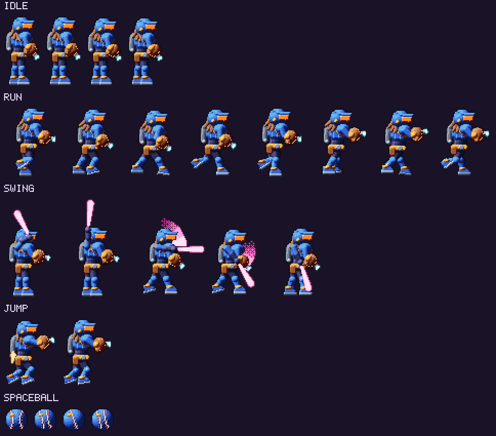

# Player and Combat

[Back to the implementation plan](../implementation-plan.md)

## Feel targets

Dawn of Sorrow is the benchmark: instant response, short attack startup,
fast recovery, a backdash that is always available, and readable damage. We
test against it in blind side-by-side playtests (see the Phase 0 exit
criteria in the [implementation plan](../implementation-plan.md#8-production-plan)).

All values assume a fixed 60 Hz simulation. Distances are in pixels, with
16 px tiles.

## Controls

| Action | Gamepad (Xbox layout) | Keyboard |
| --- | --- | --- |
| Move / aim | Left stick or D-pad | Arrow keys or WASD |
| Jump | A | Z or Space |
| Attack (main weapon) | X | X or J |
| Sub-weapon | Y | C or K |
| Backdash | LB | Shift |
| Knack (equipped tally perk) | RB | V |
| Taunt (Sleve shouts his own name) | Up + RB | Up + V |
| Holy Shades on/off | RT | Q |
| Slide | Down + Jump | Down + Jump |
| Spaceball | Double-tap Down | Double-tap Down |
| Map | View | M |
| Pause / menu | Menu | Esc |

Everything is remappable. Every hold input also has a toggle option.

## Movement

| Parameter | Value | Notes |
| --- | --- | --- |
| Run speed | 150 px/s | Full speed in 4 frames, full stop in 3 |
| Jump height | 56 px (3.5 tiles) at full hold; 24 px on a tap | Variable height: releasing Jump cuts upward speed by 55% |
| Gravity | 1,030 px/s² rising, 1,440 px/s² falling | Heavier falls feel snappy; terminal velocity is 420 px/s |
| Apex hang | Gravity x0.5 while vertical speed is under 40 px/s | Subtle float at the top of the arc |
| Coyote time / jump buffer | 6 frames each | Forgiving without feeling floaty |
| Slide | 48 px in 0.25 s; hitbox 40 px tall | Clears 3-tile-tall gaps. No invulnerability |
| Backdash | 40 px back in 0.2 s; 8 invulnerable frames | Always available, including mid-attack (a Castlevania staple) |
| Ledge grab | none | Generous corner correction (6 px) instead |

### Abilities

Where each is found is in [World and map](world-and-map.md#ability-gating).

| Ability | Spec |
| --- | --- |
| **Spaceball** | Morph in 4 frames into a 24 px ball that rolls at 130 px/s and fits 2-tile (32 px) tunnels. Pays homage to the Morph Ball, stitched like a baseball |
| **Wall Kick** | Kick off a wall for 48 px of height and 32 px of push-away. Chains indefinitely between facing walls |
| **Jetpack (double jump)** | A second jump of 40 px, for a combined reach of about 6 tiles. The jetpack flames also hurt enemies below you |
| **Plasma Whip (grapple)** | Latch onto grapple rings within 96 px and swing. Release at the bottom of the arc for maximum distance |
| **Curveball Bombs** | In Spaceball form, drop up to 3 bombs. Each breaks cracked blocks and bounces the ball 32 px (so bomb-jumps are possible) |
| **Thermos Suit** | Immunity to frost fields and heat fields, which otherwise drain 8 HP per second |
| **Aqua-Mullet** | Full-speed movement underwater. Without it, speed and jump height are halved |
| **Blast Processing** | Run for 1.5 s to hit 330 px/s. Breaks speed blocks and hurts enemies. Crouch to store the charge, then launch in any of 5 directions |
| **Screwball Attack** | A spinning jump that damages on contact, with up to 3 extra mid-air spins of 32 px each |
| **Grav-Cleats** | Hold Up under a ceiling track to attach and walk upside down at 100 px/s |
| **Holy Shades** | Toggle to reveal illusory walls, invisible platforms, and the truth about HotCoffee. The screen dims slightly while they're on |

## Weapons

Sleve carries a **main weapon** (melee) and a **sub-weapon** (ranged, which
costs EP). Each class has three base tiers, Normal (item levels 1–16),
Exceptional (17–33), and Elite (34–50), and two variants per tier. Stats and
drops are in [Progression and loot](progression-and-loot.md).

| Slot | Class | Tier examples | Speed | Reach | Signature |
| --- | --- | --- | --- | --- | --- |
| Main | **Beam Bats** | Foam Bat, Beam Bat, Photon Slugger | Medium (18-frame swing) | 40 px arc | Three-hit chain ending in a **Home Run**: heavy knockback and 6 frames of hit-stop |
| Main | **Plasma Whips** | Jump Rope, Plasma Whip, Hyperlink Lash | Slow (24 frames) | 80 px straight | Tip hits deal +25% damage. Also hooks grapple rings |
| Main | **Mega Mallets** | Squeaky Mallet, Mega Mallet, Ban Hammer | Very slow (30 frames) | 32 px overhead | Breaks enemy guard and staggers anything that isn't a boss |
| Main | **Box Cutters** | Box Cutter, Laser Letter Opener, Memo Spike | Fast (10 frames) | 24 px | Five-hit chain; +5% crit chance |
| Sub | **Mitt Cannons** | Oven Mitt, Mitt Cannon, Golden Glove Gatling | Uncharged shots are free; a full charge (0.8 s) costs 6 EP | Screen-wide | The charge shot also triggers mitt targets |
| Sub | **Spread Guns** | Pea Shooter, Scatter Blaster, Pivot Table Cannon | 4 EP per shot | 3-way spread | Short range, big crowd control |
| Sub | **Throwables** | Space Frisbee, Boomerang Card, Holo-Chakram | 3 EP per throw | Returns to Sleve | Hits twice, out and back |

**EP (energy)** regenerates 1.5 per second, and every melee hit restores 1 EP.
Mixing melee and sub-weapons keeps the meter moving.

## Damage model

The same formulas generate the numbers on the
[equipment mockup](../../assets/concept/mockups/equipment.png).

| Quantity | Formula |
| --- | --- |
| Melee ATK | weapon damage + floor(1.25 x STR) |
| Sub-weapon ATK | weapon damage + floor(0.75 x DEX + 0.5 x INT) |
| DEF | floor(CON / 2) + floor(total armor rating / 5) |
| Hit damage | max(1, round(ATK x move multiplier x 100 / (100 + target DEF) x random 0.95–1.05)) |
| Crit chance | 3% + DEX / 8, plus affixes |
| Crit damage | x1.75, plus affixes |

**Worked example.** A Lv 24 Sleve with ATK 88 hits a level 24 enemy (DEF 41)
for 88 x 100 / 141, about **62 damage**. Level 24 fodder has 211 HP, so it
takes 3–4 hits. That enemy hits Sleve (DEF 64) for 65 x 100 / 164, about
**40 damage**, so his 412 HP lasts about 10 hits.

### Elements and status effects

| Element | Status | Effect |
| --- | --- | --- |
| HEAT | Burn | 3% of max HP per second for 3 s |
| CRYO | Frostbite | 30% slower for 3 s |
| VOLT | Shock | 0.3 s stun (bosses are immune) |
| BIO | Toxic | Damage over time that stacks up to 3 times |
| VOID | Exposed | -20% DEF for 4 s |

A weakness takes x1.5 damage, a resistance x0.5, and an immunity x0.
Weakness hits show cyan numbers and, optionally, "IT'S SUPER EFFECTIVE!"

One status only affects Sleve: **Decaf** (-25% attack speed for 5 s), from
COLD BREW's attacks and any coffee-based enemy.

## Hit feedback

- **Hit-stop:** 3 frames on normal hits; 6 on crits, Home Runs, and seal
  finishers.
- **Damage numbers:** white for normal, yellow with "CRIT!" for crits, cyan
  for weaknesses, and gray for resistances.
- **Invulnerability:** 60 frames with a flicker after taking damage.
- **Knockback:** 24 px back with a small hop. VetroMania has no bottomless
  pits. Pit Birds try to knock you into them anyway, land you one floor down,
  and look disappointed.

## Enemy scaling

For an enemy of level *e*:

| Stat | Formula | At *e* = 24 |
| --- | --- | --- |
| HP | HP base x (1 + 0.14 x (*e* - 1)); fodder base 50, sturdy base 90 | 211 (fodder) |
| Contact ATK | 12 + 2.2 x *e*, times a per-attack multiplier | 65 |
| DEF | 5 + 1.5 x *e* | 41 |

- **Elites** are +2 levels with x3 HP and one elite affix: *Fast*, *Shielded*,
  *Vampiric*, *Splitting*, or *Extra Salty* (taunts you; drops +50% Vetro-Bucks).
  They roll loot 3 times.
- **Bosses** have 20 times fodder HP at their level. HotCoffee (level 32) has
  5,340 HP. **Final bosses** have 30 times: COLD BREW (level 50) has 11,790.

## Bosses and Autograph Seals

### Boss design rules

1. **Telegraph everything.** Every attack has at least 12 frames (0.2 s) of
   wind-up with a distinct pose and sound. Attacks that hit the whole screen
   get at least 30 frames.
2. **Readable phases.** At most 3 phases. Each phase change is announced by a
   pose, a palette flash, and a music layer.
3. **No damage sponges.** On Normal, a player whose gear matches the boss's
   level should win in 60–150 seconds. The loot simulator checks the spread
   of time-to-kill.
4. **Fair arenas.** No bottomless pits, no off-screen attacks, and a save pod
   right outside.
5. **Seal finish.** Every boss ends with an Autograph Seal.

### Autograph Seals

Our homage to Dawn of Sorrow's Magic Seals. When a boss hits 0 HP, time
slows to 30% and a signature plate appears. Input the required seal within
3 seconds to sign the boss off. Miss it and the boss recovers 20% HP, and the
plate returns at the next 0 HP.

| Seal | Name | Input | Found |
| --- | --- | --- | --- |
| 1 | Fastball | Down, Down-Forward, Forward, then Attack | The Signing Table in Hull Cathedral |
| 2 | Uppercut | Forward, Down, Down-Forward, then Attack | Dropped by Mother Board (Server Chapel) |
| 3 | Curveball | Back, Down-Back, Down, Down-Forward, Forward, then Attack | Dropped by Glass Jaw Joe (Laser Colosseum) |
| 4 | Spin Cycle | A full 360-degree rotation, then Attack | Dropped by Y2K (Chrono Clocktower) |
| 5 | The Code | Up, Up, Down, Down, Left, Right, Left, Right, then Sub-weapon and Attack | Dropped by Clipster (Cyber-Mall 1996), or by Missingneaux if you skipped it |

The inputs are fighting-game motions, a 90s arcade reference built into the
mechanic. The seal each boss needs is listed in the
[Bestiary](bestiary.md#bosses).

- **No softlocks.** If you don't have the seal a boss needs, the arena doors
  open after the first failed finish, and the boss stays at 20% HP until you
  come back.
- **Seal Assist** (an accessibility option) turns every seal into a single
  button press. The window doubles to 6 seconds on Babby's First Planet.

## Death, continues, and difficulty

On death, a rotating death message plays ("YOU HAVE DIED OF SPACE DYSENTERY")
and the game reloads the newer of two checkpoints: the last save pod, or the
autosave made on entering the current area.

| Mode | Damage taken | Enemy HP | Extras | Unlock |
| --- | --- | --- | --- | --- |
| Babby's First Planet | x0.5 | x0.75 | No knockback, a 6 s seal window, and gate hint arrows | Always |
| Normal | x1 | x1 | none | Always |
| Git Gud | x1.5 | x1.3 | +25% Loot Luck; enemies roll elite affixes twice as often | Any ending |
| Iron Mullet | x1 | x1 | Permadeath: one save, deleted on death. +50% Loot Luck | Any ending |

## Accessibility

- Full remapping, toggle alternatives for every hold, Seal Assist, and
  auto-fire for the Mitt Cannon.
- Game speed at 70%, 80%, or 90%.
- Sliders for screen shake, flash, and bloom intensity, plus a
  photosensitivity mode that caps flash frequency and contrast.
- Rarity is never shown by color alone. Each rarity also has its own frame
  corner and name prefix icon.
- UI scale at 1x or 2x, subtitles for all barks, and a damage-number toggle.
