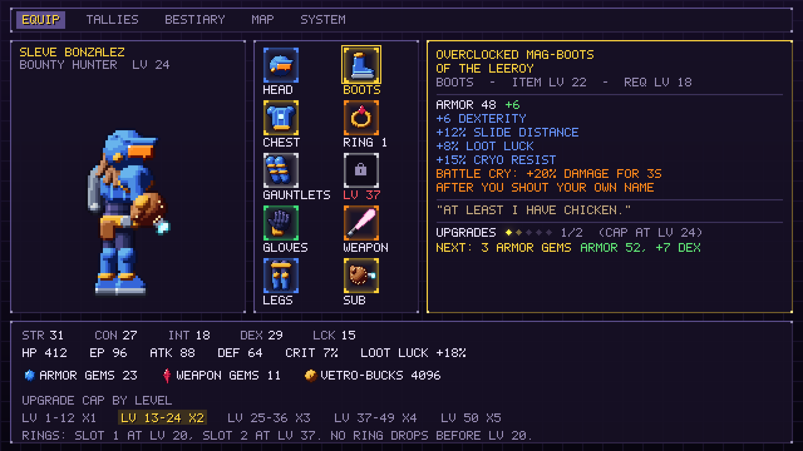
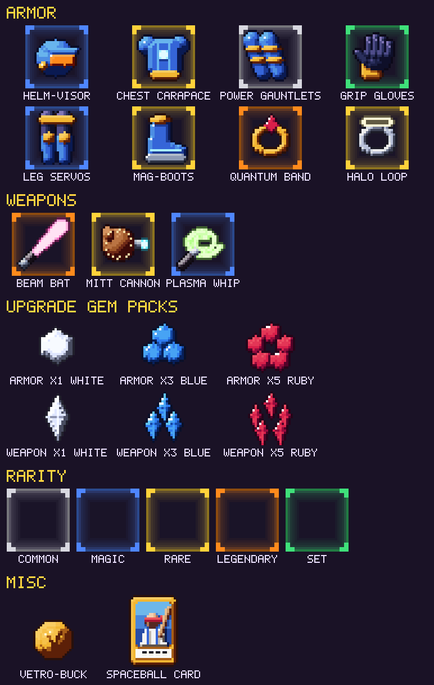

# Progression and Loot

[Back to the implementation plan](../implementation-plan.md)

Every number on the equipment mockup above comes from the formulas in this
document. The example character is Lv 24, and his rare Mag-Boots have been
upgraded once. All values are starting points for the
[loot simulator](../technical/architecture.md#loot-generator-and-simulator).

## Leveling

- **Level cap:** 50.
- **XP to reach the next level** from level *L*: `round(20 x L^2.2 + 75)`.
- **Enemy XP** at enemy level *e*: `round(4 + 3e + 0.15e^2)`. Elites give 3x,
  bosses 25x, and the first kill of each enemy type gives 5x (a bestiary
  bonus).
- **Level difference.** With *d* = enemy level minus player level:
  - *d* of +5 or more: x1.5.
  - *d* from -5 to +4: x(1 + 0.1*d*).
  - *d* of -6 or less: x0.1. No farming the crash site at Lv 30.

| Level | XP to next | Total XP to reach | On-level enemy XP | On-level kills for this level | Upgrade cap |
| --- | --- | --- | --- | --- | --- |
| 1 | 95 | 0 | 7 | 14 | +1 |
| 5 | 765 | 1,058 | 23 | 33 | +1 |
| 10 | 3,245 | 9,053 | 49 | 66 | +1 |
| 12 | 4,809 | 16,282 | 62 | 78 | +1 |
| 13 | 5,721 | 21,091 | 68 | 84 | +2 |
| 20 | 14,640 | 85,302 | 124 | 118 | +2 |
| 24 | 21,827 | 154,152 | 162 | 135 | +2 |
| 25 | 23,871 | 175,979 | 173 | 138 | +3 |
| 30 | 35,613 | 317,794 | 229 | 156 | +3 |
| 32 | 41,035 | 391,679 | 254 | 162 | +3 |
| 36 | 53,151 | 573,458 | 306 | 174 | +3 |
| 37 | 56,448 | 626,609 | 320 | 176 | +4 |
| 40 | 66,996 | 806,282 | 364 | 184 | +4 |
| 45 | 86,791 | 1,179,734 | 443 | 196 | +4 |
| 49 | 104,658 | 1,553,128 | 511 | 205 | +4 |
| 50 | max | 1,657,786 | 529 | - | +5 |

**Pacing target.** On-level kills alone reach Lv 32 (the end of Planet
VetroMania) after about 2,900 kills, and Lv 50 after about 6,200. Bosses,
elites, and first-kill bonuses cut that by 15–20%. A thorough player reaches
Lv 50 near 180% completion, and the tallies keep going after that.

## Stats

| Stat | Lv 1 | Growth per level | Drives |
| --- | --- | --- | --- |
| **STR** Strength | 8 | 0.9 | Melee ATK |
| **CON** Constitution (stamina) | 7 | 0.8 | HP and DEF |
| **INT** Intelligence | 6 | 0.5 | EP and sub-weapon ATK |
| **DEX** Dexterity | 7 | 0.7 | Crit chance and sub-weapon ATK |
| **LCK** Luck | 5 | 0.35 | Loot Luck |

A stat at level *L* is `Lv 1 value + floor(growth x (L - 1))`, plus Training
Montage points and gear.

**Training Montage.** Every 5 levels, a 5-second 80s training montage plays
(Sleve punches frozen space meat) and grants **2 free stat points**, 20 in
total by Lv 50. Anvil sells a *Montage Rewind* VHS that refunds them.

**Derived stats** (see [Player and combat](player-and-combat.md#damage-model)
for ATK, DEF, and damage):

| Derived | Formula |
| --- | --- |
| HP | 40 + 10 x CON + 3 x level |
| EP | 20 + 2 x INT + level |
| Crit chance | 3% + DEX / 8 |
| Loot Luck | floor(2/3 x LCK)%, plus affixes |

Without gear or Montage points:

| Level | STR | CON | INT | DEX | LCK | HP | EP | Crit | Loot Luck |
| --- | --- | --- | --- | --- | --- | --- | --- | --- | --- |
| 1 | 8 | 7 | 6 | 7 | 5 | 113 | 33 | 3.9% | 3% |
| 10 | 16 | 14 | 10 | 13 | 8 | 210 | 50 | 4.6% | 5% |
| 20 | 25 | 22 | 15 | 20 | 11 | 320 | 70 | 5.5% | 7% |
| 30 | 34 | 30 | 20 | 27 | 15 | 430 | 90 | 6.4% | 10% |
| 40 | 43 | 38 | 25 | 34 | 18 | 540 | 110 | 7.2% | 12% |
| 50 | 52 | 46 | 30 | 41 | 22 | 650 | 130 | 8.1% | 14% |

**The mockup, worked through.** At Lv 24 the base stats are STR 28, CON 25,
INT 17, DEX 23, and LCK 13. Add 8 Montage points (STR +3, CON +2, INT +1,
LCK +2) and the boots' +6 DEX, and you get STR 31, CON 27, INT 18, DEX 29,
and LCK 15. Then:

- **HP 412:** 382, plus 30 from a chest affix.
- **EP 96:** 80, plus 16 from a helmet affix.
- **ATK 88:** a 50-damage legendary Beam Bat plus floor(1.25 x 31).
- **DEF 64:** 13 plus 255 total armor / 5.
- **Crit 7%.**
- **Loot Luck 18%:** 10%, plus the boots' 8%.

## Gear slots

| Slot | Item family | Base stat | Unlocks | Upgraded with |
| --- | --- | --- | --- | --- |
| Helmet | Helm-Visors | Armor | Lv 1 | Armor gems |
| Breastplate | Chest Carapaces | Armor | Lv 1 | Armor gems |
| Gauntlets | Power Gauntlets (forearm) | Armor | Lv 1 | Armor gems |
| Gloves | Grip Gloves (hands) | Armor | Lv 1 | Armor gems |
| Leggings | Leg Servos | Armor | Lv 1 | Armor gems |
| Boots | Mag-Boots | Armor | Lv 1 | Armor gems |
| Ring 1 | Quantum Bands, Halo Loops | none (affixes only) | **Lv 20** | Armor gems |
| Ring 2 | Quantum Bands, Halo Loops | none (affixes only) | **Lv 37** | Armor gems |
| Main weapon | Beam Bats, Plasma Whips, Mega Mallets, Box Cutters | Damage | Lv 1 | Weapon gems |
| Sub-weapon | Mitt Cannons, Spread Guns, Throwables | Damage | Lv 1 | Weapon gems |

### Rings

- **No ring drops before the character reaches Lv 20.** Below that level, any
  ring roll is re-rolled as an armor piece. Rings can never appear before the
  first slot opens.
- Ring slot 1 opens at Lv 20 and slot 2 at Lv 37. The equipment screen shows a
  locked slot labeled with its unlock level.
- Rings have no base armor. They roll affixes only, so there are no common
  rings: a common ring roll is promoted to magic.
- **Quantum Bands** lean offensive (their affix pool favors damage and crit).
  **Halo Loops** lean defensive and utility (HP, resistances, Loot Luck).
- Rings are upgraded with armor gems. Each upgrade raises one affix by a step
  (see [Upgrades](#upgrades)).

## Item level and base stats

- **Item level (iLvl)** equals the level of the monster that dropped it. An
  elite's +2 is already in its level. A boss drop is boss level + 2. A chest
  uses its area's maximum level, and a shop uses its area's level.
- **Required level** is iLvl - 4 (minimum 1), or iLvl - 2 for legendary and
  set items. The mockup's boots are iLvl 22 and require Lv 18.
- **Base tiers:** Normal (iLvl 1–16), Exceptional (17–33), and Elite (34–50).
  Each tier has two bases per slot or weapon class.
- **Armor rating** = round(slot weight x (9 + 1.6 x iLvl) x rarity
  multiplier). The slot weights are:

  | Helmet | Breastplate | Gauntlets | Gloves | Leggings | Boots |
  | --- | --- | --- | --- | --- | --- |
  | 0.9 | 1.4 | 0.8 | 0.6 | 1.1 | 0.9 |

- **Weapon damage** = round(class weight x (8 + 1.6 x iLvl) x rarity
  multiplier). The class weights are:

  | Bat | Whip | Mallet | Cutter | Mitt Cannon | Spread Gun | Throwable |
  | --- | --- | --- | --- | --- | --- | --- |
  | 1.0 | 0.9 | 1.45 | 0.7 | 0.8 (x2.5 when charged) | 0.45 per pellet | 0.6 per hit |

  The mockup's legendary Beam Bat is iLvl 21: round(41.6 x 1.2) = 50.

## Rarity and affixes

| Rarity | Color | Affixes | Base stat multiplier | Name | Drop weight (fodder / elite) |
| --- | --- | --- | --- | --- | --- |
| Common | White `#d8d8e0` | 0 | x1.0 | The base name | 55 / 30 |
| Magic | Blue `#4f86ff` | 1–2 (at most 1 prefix and 1 suffix) | x1.05 | Prefix + base + suffix | 32 / 40 |
| Rare | Yellow `#ffd23a` | 3–5 (at most 3 prefixes and 3 suffixes) | x1.1 | Top prefix + base + top suffix | 10 / 22 |
| Set | Green `#3fe07a` | 2–3 fixed, plus set bonuses | x1.15 | Fixed | 2 / 5 |
| Legendary | Orange `#ff8a1c` | 4 random, plus 1 legendary power | x1.2 | Fixed | 1 / 3 |

**Naming rares.** A rare takes its name from its highest-tier prefix and
suffix. The mockup's *Overclocked Mag-Boots of the Leeroy* rolled three
prefixes (Overclocked, Lucky, Insulated) and two suffixes (of the Ninja, of
the Leeroy).

**Affix rules.** The pool has 40 prefixes and 40 suffixes, each with five
tiers that unlock at iLvl 1, 13, 25, 37, and 48. Affixes in the same group
can't stack on one item (for example, only one +STR suffix). Movement-speed
affixes cap at +10% in total, and **no affix grants traversal**.

A representative sample of the pool:

| Prefix | Effect | Slots | Tier 1 → tier 5 |
| --- | --- | --- | --- |
| Sturdy → Adamant | +% armor | Armor | +10% → +60% |
| Sharp → Ultra-Sharp | +% damage | Weapons | +10% → +90% |
| Hearty | +HP | Armor, rings | +10 → +80 |
| Charged | +EP | Armor, rings | +5 → +35 |
| Insulated / Fireproof / Grounded | +% CRYO / HEAT / VOLT resist | Armor, rings | +8% → +30% |
| Scorching / Frosty / Zappy / Toxic | + element damage | Weapons | +3 → +60 |
| Lucky | +% Loot Luck | Armor, rings | +3% → +15% |
| Overclocked | +% slide and backdash distance | Boots, leggings | +6% → +20% |
| Turbo | -% Blast Processing charge time | Boots | -5% → -25% |
| Vampiric | % of melee damage returned as HP | Gloves, weapons, rings | 1% → 4% |

| Suffix | Effect | Slots | Tier 1 → tier 5 |
| --- | --- | --- | --- |
| of the Bro / Tank / Nerd / Ninja / Gambler | +STR / CON / INT / DEX / LCK | Any | +1 → +15 |
| of the Sniper | +% crit chance | Weapons, gloves, rings | +1% → +6% |
| of the Headshot | +% crit damage | Weapons, helmets, rings | +10% → +50% |
| of Haste | +% attack speed | Weapons, gloves | +5% → +20% |
| of Regeneration | +HP per second outside combat | Breastplates, rings | +1 → +8 |
| of Thorns | Reflects % of melee damage taken | Armor | 5% → 25% |
| of the Mailman | +% Vetro-Bucks found | Armor, rings | +5% → +40% |
| of the Leeroy | *Battle Cry:* taunting gives +% damage for 3 s | Boots, helmets, breastplates | +10% → +30% |

### Legendaries

There are 30 legendaries, 18 on Planet VetroMania and 12 on Ainamortev. Each
has one fixed **legendary power**. Powers change how you play, but they never
open gates and never make Sleve invulnerable. Some examples:

| Legendary | Base | Power |
| --- | --- | --- |
| **The Bobson** | Beam Bat | Crits launch a spaceball that ricochets to the nearest enemy for 50% damage |
| **Pick-Axe Bat** | Beam Bat | x2 damage against rock and crystal enemies, which also drop ore worth Vetro-Bucks |
| **Spreadsheet Gun** | Spread Gun | `=SUM()`: pellets that hit the same enemy add up, then detonate for 150% |
| **Ban Hammer** | Mega Mallet | Charged overheads strip an elite's elite affix |
| **Mitt of Midas** | Mitt Cannon | Enemies killed by charged shots drop double Vetro-Bucks |
| **Mullet of Theseus** | Helmet | +1 to every stat per 10 levels. "If you replace every hair, is it the same mullet?" |
| **Leeroy's Last Stand** | Breastplate | Below 20% HP: +30% damage, and Sleve won't stop yelling |
| **Cardboard Box** | Breastplate | Stand still for 2 s and fodder enemies lose track of you, with a "?" |
| **Power Glove of Badness** | Gloves | "It's so bad." Charged Mitt Cannon shots fire twice, for +2 EP |
| **Blast Processors** | Leggings | Blast Processing charges 40% faster and leaves a damaging afterimage |
| **Barrel Roll Boots** | Boots | Double-tap backdash to barrel roll, with 20 invulnerable frames and a 3 s cooldown |
| **The Konami Band** | Ring | The first hit you take in each room deals 0 damage |
| **Hey Listen Loop** | Ring | NAG-9000 marks breakable walls up to 2 screens away. It marks them; it doesn't break them |
| **The Wololo** | Ring | 5% chance on hit to convert a fodder enemy to your side for 10 s |

### Sets

| Set | Pieces | 2-piece bonus | Full-set bonus |
| --- | --- | --- | --- |
| **Spaceball Uniform** | Helmet, breastplate, leggings, boots | +10% slide distance | Spaceball leaves a trail of fastball fire (HEAT) |
| **Barista's Apron** | Gloves, gauntlets, a ring | +15% EP regeneration | *Double Shot:* sub-weapons fire twice at 60% damage |
| **Dugnutt's Dugout** | Main weapon, gloves, helmet | +10% crit chance | Home Runs always crit |
| **Repo-Man's Collection** | Breastplate, gauntlets, boots, a ring | +20% Vetro-Bucks | Kills have a 5% chance to "repossess" an extra gem pack |
| **Cold Brew Chill Kit** (Ainamortev) | Helmet, gloves, leggings | +20% CRYO resist | Attacks have a 15% chance to cause Frostbite |
| **The Roster** (Ainamortev) | Both rings, main weapon, sub-weapon | +5 to all stats | Each kill summons a hologram teammate with a suspicious name who attacks once (up to 3 at a time) |

## Drops

### What drops

| Source | Nothing | Vetro-Bucks | Consumable | Gear | Gem pack |
| --- | --- | --- | --- | --- | --- |
| Fodder | 70% | 17% | 6% | 5% | 2% |
| Elite (rolls 3 times) | 30% | 30% | 10% | 20% | 10% |
| Boss, first kill | Guaranteed: 1 gear item of rare or better (25% legendary, 10% set), 1 blue or ruby gem pack, and a pile of Vetro-Bucks | | | | |
| Boss Rush repeat kills | 1 gear item with rare, set, and legendary weights tripled, plus 1 gem pack | | | | |
| Secret chest (40 per planet) | 1 gear item of rare or better (15% legendary, 10% set), plus a 50% chance of a gem pack | | | | |

**Which slot:** armor 60%, weapons 25%, and rings 15%. Ring rolls become
armor until the character is Lv 20.

### Loot Luck

Loot Luck (*LL*, in percent) is VetroMania's magic find. Common weight is
unchanged. Each better tier's weight is multiplied by `1 + LL_t / 100`,
where `LL_t = LL x K / (LL + K)` gives diminishing returns:

| Tier | K |
| --- | --- |
| Magic | no cap (`LL_t = LL`) |
| Rare | 600 |
| Set | 500 |
| Legendary | 250 |

At the mockup's 18% Loot Luck, rares and legendaries are both about x1.17 as
likely. At 100%, rares are x1.86 and legendaries x1.71.

### Bad-luck protection

If 40 rare-or-better drops in a row include no legendary, the next one is a
legendary. The same applies to set items after 30 such drops, and it favors a
set you haven't completed. The counters are saved.

### Target outcomes

The loot simulator enforces these targets on Normal, with a player who is
thorough but not grinding:

| Point in the game | Gear drops | Rares | Legendaries | Set pieces | Gems |
| --- | --- | --- | --- | --- | --- |
| End of Planet VetroMania (~Lv 32, ~12 h) | ~250 | ~65 | ~10 of 18 | ~10 (usually 1–2 full sets) | ~240 |
| 200.6% (~Lv 50, 35–40 h) | ~600 | ~170 | 25+ of 30 | All 6 sets completable | ~700 |

## Upgrades

Any armor piece, ring, or weapon can be upgraded at the **upgrade bench** in
any save pod. How many times depends on the **character's level band**, as
the proposal specifies:

| Character level | Upgrade cap per item |
| --- | --- |
| 1–12 | +1 |
| 13–24 | +2 |
| 25–36 | +3 |
| 37–49 | +4 |
| 50 | +5 |

- **The cap follows the character, not the item.** An item upgraded to +2
  at Lv 20 stays +2, and can go to +3 once Sleve reaches Lv 25.
- **Cost to go from +n to +(n+1):**

  | Step | +1 | +2 | +3 | +4 | +5 | Total |
  | --- | --- | --- | --- | --- | --- | --- |
  | Gems | 1 | 3 | 5 | 8 | 12 | 29 |

  Each step also costs a Vetro-Bucks fee of 25 x iLvl x (n + 1).
- **Effect of each step:** +10% of the item's base stat (armor or damage,
  rounded down). You also pick one of the item's affixes to raise by one step,
  which is a fifth of its tier's range. Common items have no affixes, so they
  get +15% base per step instead. At +5 the item gets a chrome finish.
- **Salvage.** Anvil breaks down an upgraded item and refunds half the gems
  spent on it, rounded down, so replacing gear never feels like a total loss.

**Example: the mockup's boots.** *Overclocked Mag-Boots of the Leeroy* is a
rare at iLvl 22 with base armor 44 (0.9 x 44.2 x 1.1).

| Upgrade | +0 | +1 | +2 | +3 | +4 | +5 |
| --- | --- | --- | --- | --- | --- | --- |
| Armor | 44 | 48 | 52 | 57 | 61 | 66 |
| Cap allows it from level | - | 1 | 13 | 25 | 37 | 50 |

At Lv 24 the boots are +1 of a possible +2. The next step costs 3 armor gems
and gives armor 52 and +7 DEX, exactly as the mockup's tooltip says.

## Upgrade gems

- Two kinds: **armor gems** (all armor pieces and both rings) and **weapon
  gems** (main weapon and sub-weapon). Each drop is 50/50 between them.
- Gems drop in packs. The pack's color is its size:

  | Pack | Gems | Fodder and elite odds | Boss odds | Chest odds |
  | --- | --- | --- | --- | --- |
  | White | 1 | 70% | - | 40% |
  | Blue | 3 | 25% | 70% | 45% |
  | Ruby | 5 | 5% | 30% | 15% |

- Gems and Vetro-Bucks are collected automatically within 48 px, so you never
  backtrack for a single white gem.

## Economy

**Vetro-Bucks** are the currency.

- **Sources.** Drops (2 + 1.5 x enemy level, ±20%; elites x5), bosses, the
  ore from Pick-Axe Bat kills, and selling gear at 10 x iLvl x a rarity factor
  (common 1, magic 2, rare 4, set 8, legendary 10).
- **Sinks:**
  - Consumables: Wall Pockets (the SotN wall-meat homage), Space Burritos,
    and energy drinks.
  - Anvil's base gear, stocked at the area's level.
  - Upgrade fees.
  - Montage Rewind tapes.
  - HotCoffee's cafe buffs in Ainamortev.
  - **The Loot Crate vendor** in Cyber-Mall 1996. Pay for a sealed item of a
    chosen slot, with rare-or-better weights x1.5. It's the gamble vendor
    from Diablo II, and a joke about loot boxes, with no real money involved.

## Loot presentation

- **Loot beams** in the rarity color. Legendaries also play a sting, and the
  gameplay mockup shows a rare's yellow beam.
- **Pickup toast.** Name, rarity, and up and down arrows comparing it with the
  equipped item. Legendary and set items drop **unidentified** ("???"), and
  Deckard Cane identifies them for free.
- **Inventory** is a sortable list per slot, not a grid. Items can be marked
  as junk, and Anvil sells all junk in one go.
- Rarity is shown by color and by frame-corner shape, and never by color
  alone.

## Kill Tallies

Tally perks are the fifth progression track, alongside levels, gear,
upgrades, and abilities. The thresholds, perks, and loadout rules are in the
[Bestiary](bestiary.md#kill-tallies).
