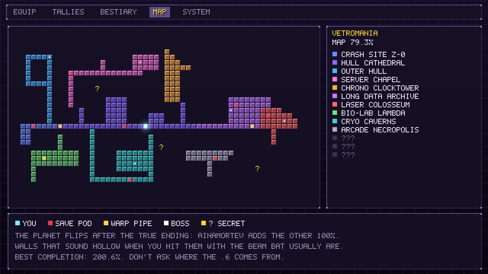
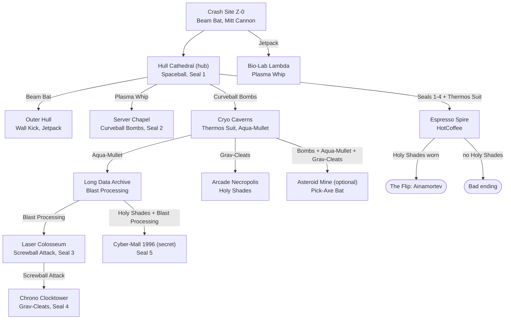
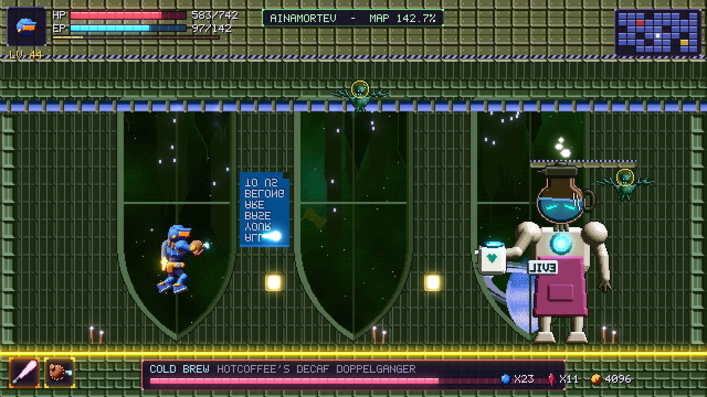

# World and Map

[Back to the implementation plan](../implementation-plan.md)

> The first playable slice covers three areas and 13 cells. See
> [The vertical slice](#the-vertical-slice).



## The planet

VetroMania is a glass-and-steel cathedral planet wrapped around the
**Gravity Organ**, a planet-sized pipe organ that keeps it right side up. The
map is one interconnected space, with no levels and no loading screens except
elevator rides. The **Espresso Spire**, HotCoffee's keep, rises out of the hub
and is visible from most of the planet.

### Map grid

- One **map cell** is 40 x 23 tiles (640 x 368 px) of 16 px tiles. That's one
  screen, plus 8 px of vertical scroll so single-cell rooms never feel dead.
- Rooms are rectangles or unions of whole cells. Doors sit on cell edges.
- Each planet has about **600 cells**. Completion counts visited cells, as in
  Symphony of the Night.

## Areas of Planet VetroMania

Codes match the [map mockup](../../assets/concept/mockups/world_map.png).
Levels are enemy levels, which set item levels too.

| Code | Area | Look and feel | Levels | Cells | Boss | Rewards | Entry needs |
| --- | --- | --- | --- | --- | --- | --- | --- |
| C | **Crash Site Z-0** | The smoking wreck of *The Dugnutt* in a glass-sand crater. Tutorial | 1–3 | 20 | none (Latte-Tron is fought in the prologue) | Beam Bat, Mitt Cannon | Start |
| H | **Hull Cathedral** (hub) | A stained-glass nave bolted onto a starship hull. Anvil's shop, Deckard Cane, the Spire door | Tracks progress | 70 | Gargle-oyle Prime (mini) | Spaceball, Seal 1 | From C |
| O | **Outer Hull** | Vacuum walkways on the orbital shell, with low-gravity pockets and space monkeys | 5–10 | 50 | KRATE | Wall Kick, Jetpack | Beam Bat |
| B | **Bio-Lab Lambda** | An overgrown lab: vines, specimen tanks, and "THE CAKE IS A LIE" graffiti | 8–13 | 45 | The Great Mighty Goo | Plasma Whip | Jetpack |
| S | **Server Chapel** | Server racks as pews, stained-glass monitors, and monks chanting modem noises | 11–16 | 50 | Mother Board | Curveball Bombs, Seal 2 | Plasma Whip |
| K | **Cryo Caverns** | Frozen caves, a flooded lake, and a ski-slope chase | 14–19 | 55 | Loch Ness Monster Truck; the Abominable Snow-Bot chase | Thermos Suit, Aqua-Mullet | Curveball Bombs |
| D | **Long Data Archive** | A library corridor of tapes and floppies so long it has its own weather | 17–22 | 60 | Dewey Decimator | Blast Processing | Aqua-Mullet |
| L | **Laser Colosseum** | An arena of laser grids with wave challenges (the best tally farming) | 20–25 | 35 | Glass Jaw Joe | Screwball Attack, Seal 3 | Blast Processing |
| T | **Chrono Clocktower** | A giant clock tower with grinding gears and time-stop hazards | 23–28 | 45 | Y2K | Grav-Cleats, Seal 4 | Screwball Attack |
| A | **Arcade Necropolis** | A graveyard of arcade cabinets, haunted by ghosts, where the far rooms glitch like a kill screen | 25–30 | 50 | Kill Screen | Holy Shades | Grav-Cleats |
| M | **Asteroid Mine** (optional) | A captured asteroid with a minecart run and Minesweeper floor puzzles | 26–32 | 35 | Miner 2049-er | Legendary Pick-Axe Bat | Bombs, Aqua-Mullet, and Grav-Cleats |
| V | **Cyber-Mall 1996** (secret) | A dead mall crossed with a 90s homepage: under-construction signs, a hit counter, and a food court | 28–34 | 30 | Clipster | Seal 5, legendary Spreadsheet Gun | Holy Shades and Blast Processing |
| E | **Espresso Spire** | HotCoffee's keep: boiling coffee rivers and conveyor grinders | 30–34 | 55 | HotCoffee | An ending | Seals 1–4 and the Thermos Suit |

Map colors, used by the map screen and area title cards:

| Area | Color | Area | Color | Area | Color |
| --- | --- | --- | --- | --- | --- |
| C | `#6f8cff` | S | `#ff7ad8` | A | `#b0b0c8` |
| H | `#8a6cff` | K | `#3fd0d0` | M | `#c89a6a` |
| O | `#4fb3ff` | D | `#c07aff` | V | `#5ff0c8` |
| B | `#6fe07a` | L | `#ff6a6a` | E | `#ff4a6a` |
| T | `#ffb04a` | | | | |

### The hub levels up

Hull Cathedral's enemies match the lowest level of the newest area you've
unlocked, and its elites spawn 2 levels higher. The hub is always a fair place
to farm tallies and loot. Every other area has fixed levels, so
over-leveling is a player choice, as in Dawn of Sorrow.

The [gameplay mockup](../../assets/concept/mockups/gameplay.png) shows this:
a Lv 18 Sleve in the hub just after the Laser Colosseum opened (hub level
20), and a hub elite has dropped an item level 22 rare.

## Ability gating

Every gate has a unique silhouette and color, readable **before** you own the
ability, so players know to come back. This is the Metroid rule.

| Gate | Looks like | Opened by | Where the ability is found |
| --- | --- | --- | --- |
| Crate bulkhead | Stacked cargo crates with a bat decal | Beam Bat | C, from a vending machine ("IT'S DANGEROUS TO GO ALONE") |
| Mitt target | A glowing catcher's-mitt bullseye | Mitt Cannon charge shot | C, in the ship's wreckage |
| Vent tunnel (2 tiles tall) | A grated duct | Spaceball | H, from the Koozie Statue |
| Tall shaft | Two parallel walls with kick scuffs | Wall Kick | O, taught by the Space Monkeys |
| High ledge (5–6 tiles) | A ledge with a jet-scorch mark | Jetpack (double jump) | O, dropped by KRATE |
| Grapple ring | A neon ring in the ceiling | Plasma Whip | B, dropped by the Great Mighty Goo |
| Cracked block | A spiderweb crack in glass | Curveball Bombs | S, dropped by Mother Board |
| Frost or heat field | Icy haze, or heat shimmer | Thermos Suit ("keeps cold things cold and hot things hot") | K, at the end of the Snow-Bot chase |
| Deep water | Full-screen water | Aqua-Mullet ("business in the front, gills in the back") | K, dropped by the Loch Ness Monster Truck |
| Speed block | Chevron-striped blocks | Blast Processing | D, dropped by the Dewey Decimator |
| Screw block | A block with a spiral bolt | Screwball Attack | L, dropped by Glass Jaw Joe |
| Ceiling track | A magnetic rail on the ceiling | Grav-Cleats | T, dropped by Y2K |
| Illusory wall, invisible platform | A faint stained-glass shimmer | Holy Shades | A, dropped by Kill Screen |
| Spire door | A door with four signature plates | Autograph Seals 1–4 | H, S, L, and T |

**Kill Tally perks never open gates.** Echolocation Ping, for example, reveals
breakable walls but can't break them. The reachability solver treats perks as
absent, so they can never change what's reachable.

### Critical path



The Arcade Necropolis, the Asteroid Mine, and the Cyber-Mall aren't needed to
reach HotCoffee. NAG-9000 strongly hints at the Holy Shades, and the bad
ending's final hint points straight at them.

### Intended sequence breaks

Speedrunners will find routes, so the known ones are designed in and tested:

1. **Bomb-jump into the Server Chapel.** Chained Curveball Bomb jumps skip the
   Plasma Whip grapple. It's a Metroid bomb-jump homage.
2. **Blast-Processing spark up the Clocktower.** A stored speed charge
   launches straight up the lower shaft without the Screwball Attack.
3. **Wall Kick into Bio-Lab Lambda.** A tight kick chain in the crash-site
   crevice skips the Jetpack.

The reachability solver proves that each break still leads to a completable
state, with no softlocks.

### Secrets

- **Breakable walls** make a hollow "tonk" when hit with the Beam Bat. The
  Space Bat tally perk *Echolocation Ping* highlights them within one screen.
- **Illusory walls and invisible platforms** need the Holy Shades.
- **Secret chests:** 40 per planet, each rolling at least rare quality (see
  [Progression and loot](progression-and-loot.md#drops)).
- **Minus World:** six cells hidden outside Ainamortev's map bounds (see
  [Completion](#completion-math)).

## Save pods, warps, and the map screen

- **Save pods** (red on the map) sit at most 6 cells apart on the critical
  path and always right before a boss. A pod fully heals Sleve and hosts the
  upgrade bench and Knack loadout.
- **Warp pipes** (yellow) connect to a hub room called The Plumbing ("WELCOME
  TO WARP ZONE!"). There are 1–2 per area, 20 per planet.
- **The map screen** matches the mockup's legend: *You*, *Save pod*, *Warp
  pipe*, *Boss*, and *? Secret*. The ? marks are suspected secrets that
  NAG-9000 has flagged. Players can drop up to 20 custom pins with icons.
- **The minimap** in the HUD shows the surrounding 9 x 6 cells.
- **Area title cards** fade in on first entry, in the area's map color.

## The Flip



**Trigger:** defeat HotCoffee while wearing the Holy Shades. The Shades reveal
puppet strings; cutting them unmasks COLD BREW, who plays the Symphony of the
Spaceball. The planet turns upside down in a single scripted sequence, and
Sleve wakes in **Ainamortev** (VetroMania spelled backwards).

**What changes:**

- **Geometry.** Every room is flipped vertically, so ceilings become floors,
  just as in Symphony of the Night's inverted castle. Room layouts come from
  an automated flip plus hand-authored **patch layers** that add platforms,
  new gates, and new secrets (see
  [Architecture](../technical/architecture.md#the-flip-pipeline)).
- **Palette.** Area palettes are hue-rotated and slightly darkened, and the
  sky is a new nebula.
- **Enemies.** Every enemy returns as a palette-swapped mirror variant with
  one new move, joined by 10 Ainamortev-only enemies. See the
  [Bestiary](bestiary.md#mirror-variants).
- **Bosses.** 13 new bosses, plus a secret one.
- **Open world.** You arrive with every ability, so Ainamortev gates combine
  abilities (for example, Grav-Cleats plus Blast Processing on a ceiling speed
  run) instead of introducing new ones.
- **Travel.** After the Flip, the Gravity Organ console in the Reverse
  Cathedral flips the planet on demand. Nothing on either planet is missable.

### Ainamortev areas

Ainamortev is open, and these level ranges suggest an order.

| Code | Twin of | Ainamortev area | Levels | Boss | Twist |
| --- | --- | --- | --- | --- | --- |
| C | Crash Site Z-0 | **Launch Site 0-Z** | 32–34 | Repo-Man | The wreck is now a launch pad, and HotCoffee runs a pop-up cafe that sells buffs |
| H | Hull Cathedral | **Reverse Cathedral** (hub) | Tracks progress | Gargle-oyle Omega | Home of the Gravity Organ console |
| O | Outer Hull | **Inner Hull** | 34–37 | ETARK | The inside of the hull, with zero-g pockets |
| B | Bio-Lab Lambda | **Bio-Lab Adbmal** | 35–38 | The Great Mighty Ooze | Vines grow downward and spores rain upward |
| S | Server Chapel | **Client Chapel** | 36–39 | Father Board | Every door asks for permission first |
| K | Cryo Caverns | **Sauna Caverns** | 37–40 | Loch Less Monster | Heat instead of frost; the Thermos Suit matters again |
| D | Long Data Archive | **Short-Term Memory** | 38–41 | Goldfish | The endless corridor is now a vertical speed shaft |
| L | Laser Colosseum | **Loser Colosseum** | 39–42 | The Entire Roster | Consolation-prize challenges; every participant gets a trophy |
| T | Chrono Clocktower | **Counter-Clocktower** | 40–43 | Y1K | Time runs backward and the gears reverse |
| A | Arcade Necropolis | **Arcade Metropolis** | 41–45 | High Score (and the secret Sheng Wrong) | The dead cabinets are alive and crowded |
| M | Asteroid Mine | **Asteroid Yours** | 42–46 | Miner 4902-er | An open pit where you're the ore |
| V | Cyber-Mall 1996 | **Cyber-Mall 6991** | 44–48 | Missingneaux | A glitched mall from the far future |
| E | Espresso Spire | **Decaf Dungeon** | 46–50 | COLD BREW | The inverted Spire: cold and dripping. Needs Seal 5 |

**No softlock on Seal 5.** If the player flips without visiting Cyber-Mall
1996, Missingneaux drops Seal 5 in Cyber-Mall 6991.

## Completion math

- Each planet contributes up to **100.0%**: visited cells divided by that
  planet's cell count. With about 600 cells, each is worth about 0.17%.
- The six **Minus World** cells, hidden outside Ainamortev's map bounds,
  are worth exactly **0.1%** each.
- **Maximum: 100.0 + 100.0 + 0.6 = 200.6%**, an intentional nod to Symphony
  of the Night.
- The display **truncates** to one decimal place, so it never shows 100.0%
  before the last cell. The
  [Ainamortev mockup](../../assets/concept/mockups/mirror.png) shows a
  combined 142.7%.
- The first Minus World cell is behind a truck in the Launch Site. Nothing is
  under the truck. Players will check anyway.

## The vertical slice

The first playable build covers the prologue, the first wing of the hub, and
the first boss: **11 rooms in 13 cells** across Crash Site Z-0, Hull Cathedral,
and the Outer Hull, ending at KRATE. It implements the first five rows of the
[gating table](#ability-gating). Every room is a JSON file, and the
[level format](../technical/level-format.md) says how to author one.

```text
     0  1  2  3  4  5  6  7  8  9
  0  .  .  .  .  G  L  .  .  S  A
  1  1  2  3  N  V  V  C  D  S  .
```

`1` Impact Crater, `2` Wreckage Field, `3` Conduit Yard, `N` Narthex, `V` Nave
(two cells), `G` Gallery, `L` Ledge, `C` Cloister, `D` Deck One, `S` Shaft (two
cells), `A` Cargo Bay Nine.

| Room | Cell | What's there |
| --- | --- | --- |
| Impact Crater | 0,1 | The start. Movement hints, Onson Sweemey, and the vending machine that hands over the **Beam Bat**. A crate bulkhead blocks the east exit until you swing it |
| Wreckage Field | 1,1 | Kevin Nogilny, the first zombies and bats, and the **Mitt Cannon** orb |
| Conduit Yard | 2,1 | Darryl Archideld. Optional: a charged shot at the bullseye across the yard opens the conduit closet and its chest |
| The Narthex | 3,1 | The first **save pod**, Glenallen Mixon, a warp pipe, and the first Hunch-Bot |
| The Nave | 4–5,1 | The Koozie Statue (**Spaceball**), Anatoli Smorin, and Mike Sernandez. One-way platforms climb like a staircase to the gallery and the ledge |
| The Gallery | 4,0 | A closet at the end of a 2-tile ball tunnel, holding a chest |
| The Ledge | 5,0 | A chest floating out of reach until you have the **Jetpack**, so it's a return trip after KRATE |
| The Cloister | 6,1 | Willie Dustice, the signing table (**Autograph Seal 1**), a hollow wall that hides a secret chest, and a crate bulkhead to the Outer Hull |
| Deck One | 7,1 | A spike pit, then the **Wall Kick** orb |
| The Shaft | 8,0–1 | A 4-tile-wide wall-kick climb. The landing has a second warp pipe, a save pod, and four holograms |
| Cargo Bay Nine | 9,0 | The boss door, and **KRATE**. On his defeat, the Jetpack orb appears and the slice's end card follows |

**Critical path.** Beam Bat, then the crate bulkhead, then the Mitt Cannon.
Continue through the Narthex and the Nave (the Spaceball is optional) to the
Cloister and its Seal, break the second bulkhead, take the Wall Kick from Deck
One, climb the Shaft, and finish at the pod before Cargo Bay Nine.

**Secrets** (each is tested both ways, reachable with its ability and not
without it):

- **The conduit closet.** It needs a fully charged Mitt Cannon shot.
- **The Gallery closet.** It needs the Spaceball.
- **The floating chest.** It needs the Jetpack, and neither the Wall Kick nor
  the Spaceball is enough.
- **The hollow wall.** It tonks on the first two bat hits and breaks on the
  third. Its chest stays hidden until then.

**Left out of the slice**, and still to build: Gargle-oyle Prime and Seal 1's
place as its reward, the other nine areas and their abilities, the Anvil and
Deckard shops, the Bestiary tab, the Flip, and the mirror planet. The
[status table](../technical/architecture.md#vertical-slice-as-built) lists
everything that differs from the plan.
