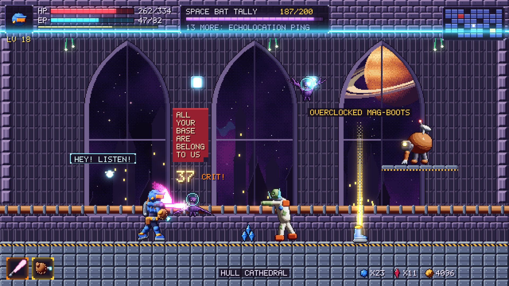

# VetroMania: Implementation Plan

> **Status:** pre-production plan, v0.1. Everything here is a proposal to be
> proven by the prototype and vertical slice. Numbers are starting values for
> tuning, not promises.

**VetroMania: Symphony of the Spaceball** is a 2D sci-fi Metroidvania.
Space bounty hunter **Sleve Bonzalez** crash-lands on the gothic glass planet
VetroMania to recover his favorite spaceball card, a 1994 holo-foil Bobson
Dugnutt rookie. The card was stolen by **HotCoffee**, an evil android barista
with a completionist streak. Beat HotCoffee the right way and the planet flips
over into its mirror, **Ainamortev**. Full exploration tops out at 200.6%.

## Contents

1. [Vision and pillars](#1-vision-and-pillars)
2. [Influences](#2-influences)
3. [Requirements traceability](#3-requirements-traceability)
4. [Game structure](#4-game-structure)
5. [Systems at a glance](#5-systems-at-a-glance)
6. [Technical approach](#6-technical-approach)
7. [Content budget](#7-content-budget)
8. [Production plan](#8-production-plan)
9. [Risks](#9-risks)
10. [Assumptions and gap decisions](#10-assumptions-and-gap-decisions)
11. [Open questions](#11-open-questions)

Detailed design documents:

| Document | Covers |
| --- | --- |
| [Story and tone](design/story-and-tone.md) | Premise, cast, story beats, endings, and humor guardrails |
| [World and map](design/world-and-map.md) | The 13 areas, ability gating, the Flip, and 200.6% completion |
| [Player and combat](design/player-and-combat.md) | Controls, movement, abilities, damage, bosses, and Autograph Seals |
| [Progression and loot](design/progression-and-loot.md) | XP and stats, gear slots, rarity, affixes, drops, and gem upgrades |
| [Bestiary](design/bestiary.md) | Enemies, kill tallies and perks, mirror variants, and bosses |
| [Reference ledger](design/reference-ledger.md) | 120 references and memes, with placement and legal-risk tags |
| [Technical architecture](technical/architecture.md) | Engine, data model, loot generator, save and map systems, tools, and testing |
| [Art direction](art/art-direction.md) | Resolution, sprite specs, palettes, animation budgets, and pipeline |

## 1. Vision and pillars

**One-line pitch:** *Dawn of Sorrow's feel, Diablo's loot, and a 200.6% map,
wrapped in a planet-sized bit about 90s video games.*

Every feature must serve at least one pillar. When two pillars conflict, the
lower number wins.

1. **It feels like Dawn of Sorrow.** Snappy movement, instant attacks,
   generous hitboxes, readable bosses, and a map that pulls you forward. Game
   feel is never sacrificed for a joke or a loot number.
2. **Every room pays off.** Each screen should reward curiosity: a secret
   wall, a loot drop, a tally tick, a map cell, or a joke. Ability gates make
   backtracking a reward instead of a chore.
3. **Loot you can read at a glance.** Diablo's rarity colors, affixes, sets,
   and legendary powers, cut down for a game with a few enemies per room.
   Level-banded upgrade caps keep gear from trivializing bosses.
4. **Crammed to the gills with references.** Game and internet memes from
   every era, weighted toward the 90s. They're delivered through names,
   flavor text, props, and barks, and they're funny even if you miss the
   reference.

**Non-goals:** no roguelite runs or procedural maps, no 3D, no multiplayer, no
live service, and no microtransactions. The Loot Crate Mimic enemy is the
only "surprise mechanic".

## 2. Influences

| Influence | What we take | What we leave |
| --- | --- | --- |
| Metroid and Super Metroid | A lonely sci-fi planet, suit upgrades that gate exploration (the Morph Ball becomes Spaceball), item fanfares, and an escape sequence | Sparse combat: VetroMania is combat-dense |
| Castlevania: Symphony of the Night | Gothic interconnected map, map-percent obsession, RPG levels and loot, the inverted castle, 200.6%, and a bad ending gated by special glasses | Game-breaking item exploits: upgrades are capped by level |
| Castlevania: Aria of Sorrow | Powers earned from specific enemies, and a post-game alternate character | Random soul drops: tallies are deterministic kill counts |
| Castlevania: Dawn of Sorrow | The feel: backdash, fast attacks, damage numbers, and magic-seal boss finishers (our Autograph Seals) | Touchscreen gimmicks |
| Bloodstained | Modern resolution and readability, lush gothic color, and quality-of-life features (map pins, fast travel) | 3D models: we stay in pixels |
| Diablo II and III | Rarity colors, prefix/suffix affixes, sets, legendary powers, magic find (our Loot Luck), and a hardcore mode | Inventory grids, mob density, and trading |
| *DudeBro 2: It's Straight Up Dawg Time* | Satire of macho games: absurd titles, a deadpan bro hero, crude but self-aware humor | Nothing. That's the tone |

## 3. Requirements traceability

Every item in the original proposal, and where the plan answers it.

| Proposal item | Design answer | Detail |
| --- | --- | --- |
| 2D space platformer; Sleve Bonzalez hunts HotCoffee for his stolen spaceball card | Premise, cast, four-act story, two endings | [Story and tone](design/story-and-tone.md) |
| Planet VetroMania in a 90s sci-fi platformer art style | 13 themed areas on one interconnected map; HD pixel art | [World and map](design/world-and-map.md), [Art direction](art/art-direction.md) |
| Fantasy monsters transposed to sci-fi "in a humorously lazy way" | 40 base enemies (Space Bat, Astro-Zombie, Hunch-Bot, Mer-Man, Vampress, and more) and 27 bosses | [Bestiary](design/bestiary.md) |
| Areas reachable only with specific capabilities | 13 abilities and 5 Autograph Seals, a gating matrix, and a reachability solver in CI | [World and map](design/world-and-map.md#ability-gating), [Architecture](technical/architecture.md#reachability-solver) |
| The planet flips after the main story; 200% to fully explore | The Flip into Ainamortev, with remixed areas, mirror enemies, and harder bosses; max completion 200.6% | [World and map](design/world-and-map.md#the-flip) |
| Leveling with XP, and stat boosts per level | Levels 1 to 50, five stats with fixed growth, and a Training Montage every 5 levels | [Progression and loot](design/progression-and-loot.md#leveling) |
| Killing ~200 of one enemy grants a fun, non-game-breaking perk | Kill Tallies: 200 for fodder and sturdy enemies, 100 for elite types, 25 for rare spawns. Perks never bypass ability gates | [Bestiary](design/bestiary.md#kill-tallies) |
| Leveled armor and weapon drops; bosses drop better loot | Item level equals monster level; bosses guarantee rare or better | [Progression and loot](design/progression-and-loot.md#drops) |
| Slots: helmet, breastplate, gauntlets, gloves, leggings, boots, and two rings | Eight gear slots plus a main weapon and a sub-weapon | [Progression and loot](design/progression-and-loot.md#gear-slots) |
| Ring slots at Lv 20 and Lv 37; no ring drops before Lv 20 | Enforced both in the slot unlocks and in the drop table | [Progression and loot](design/progression-and-loot.md#rings) |
| Upgrade caps by character level: 1 / 2 / 3 / 4 / 5 | Bands 1–12, 13–24, 25–36, 37–49, and 50 | [Progression and loot](design/progression-and-loot.md#upgrades) |
| Armor and weapon gems drop in 1 / 3 / 5 packs (white / blue / ruby) | Gem pack drop odds, upgrade costs, and effects | [Progression and loot](design/progression-and-loot.md#upgrade-gems) |
| Diablo loot as a superset, watered down | Five rarities, 80 affixes, 30 legendaries, 6 sets, Loot Luck | [Progression and loot](design/progression-and-loot.md#rarity-and-affixes) |
| Principle: it feels like Dawn of Sorrow | Movement and combat specs, backdash, damage numbers, seal finishers | [Player and combat](design/player-and-combat.md) |
| Principle: crammed with 90s references and memes from all eras | 120-entry reference ledger with placement and risk tags | [Reference ledger](design/reference-ledger.md) |
| Graphics one to two generations after the Nintendo DS | 640x360 native HD pixel art, integer-scaled to 1080p and 4K, with bloom | [Art direction](art/art-direction.md) |

## 4. Game structure

**Core loop (minutes):** explore a room, fight what's in it, grab the drops,
and tick a tally. Find a gate you can't pass yet and mark it on the map.

**Progress loop (an hour):** reach a boss, finish it with an Autograph Seal,
earn a new ability, then backtrack through old gates to new areas, secrets,
and better loot.

**Meta loop (the whole game):** level to 50, fill the tallies, upgrade a
favorite set of gear to +5, and push the map toward 200.6%.

| Phase | Content | Target time |
| --- | --- | --- |
| Prologue | Sleve at full power loses everything in a crash (SotN style) | 10 minutes |
| Planet VetroMania | 13 areas, ~600 map cells, 13 bosses, all 13 abilities | 10–12 hours |
| Bad ending | Beat HotCoffee without the Holy Shades: credits, and a hint | Optional |
| The Flip | Beat HotCoffee while wearing the Holy Shades; the planet turns over | Scripted sequence |
| Ainamortev | 13 remixed areas, ~600 cells, 13 new bosses, and a secret boss | 10–14 hours |
| Completion | 200.6% map, all 90 tallies, Lv 50, all legendaries | 35–40 hours |
| Post-game | Bobson Mode (play as Bobson Dugnutt), Boss Rush, and Iron Mullet (permadeath) | Replay |

**Platforms:** PC (Steam) first, Steam Deck verified at launch, and consoles
through a porting partner. **Rating target:** ESRB T and PEGI 12 (fantasy
violence, crude humor, and mild language), confirmed through the rating
questionnaires during beta.

## 5. Systems at a glance

- **Movement and combat.** DoS-style run, jump, slide, and backdash. The
  Beam Bat (melee) and Mitt Cannon (ranged) are the starting weapons. Damage
  numbers, crits, five elements, and short, readable hit-stun.
  See [Player and combat](design/player-and-combat.md).
- **Abilities and gates.** Spaceball, Wall Kick, Jetpack double jump, Plasma
  Whip grapple, Curveball Bombs, Thermos Suit, Aqua-Mullet, Blast Processing,
  Screwball Attack, Grav-Cleats, and Holy Shades. Each opens a distinct gate
  type. See [World and map](design/world-and-map.md#ability-gating).
- **Autograph Seals.** Bosses at 0 HP must be finished with a directional
  input "signature" within 3 seconds or they recover 20% HP. Five seals are
  found in the world. This is our homage to Dawn of Sorrow's Magic Seals.
- **Leveling.** Lv 1–50 with automatic stat growth. Every 5 levels a Training
  Montage grants 2 free stat points.
  See [Progression and loot](design/progression-and-loot.md#leveling).
- **Kill Tallies.** Each enemy type counts kills toward a perk: a small trait
  boost (always on) or a Knack (equipped in one of 3 slots).
  See [Bestiary](design/bestiary.md#kill-tallies).
- **Loot.** Item level equals monster level. Five rarities: common, magic,
  rare, legendary, and set. Prefix/suffix affixes, and Loot Luck (magic find)
  with diminishing returns.
- **Upgrades.** Spend armor or weapon gems to raise an item's upgrade level.
  The ceiling is set by your character-level band.
- **Map and the Flip.** A SotN-style cell map with per-planet completion.
  The Flip inverts the planet into Ainamortev, and six hidden Minus World
  cells supply the final 0.6%.
- **Economy.** Vetro-Bucks come from drops and selling gear. They're spent on
  consumables, base gear, upgrade fees, and the occasional joke item.
- **Difficulty.** Babby's First Planet (easy), Normal, Git Gud (unlocked after
  a clear), and Iron Mullet (permadeath). Language mode is Salty or Decaf
  (bleeped).

## 6. Technical approach

Full detail is in [Technical architecture](technical/architecture.md).

- **Engine: Godot 4 (GDScript).** It has strong 2D tooling, pixel-perfect
  integer scaling, no royalties, and source access. Consoles ship through a
  third-party porting partner, engaged in pre-production.
- **Native 640x360**, integer-scaled to 720p (2x), 1080p (3x), 1440p (4x),
  and 4K (6x). Bloom is computed at native resolution.
- **Data-driven content.** Enemies, items, affixes, legendaries, sets, tally
  perks, and rooms are data resources validated in CI. Designers tune numbers
  without touching code.
- **Deterministic systems.** Loot rolls use seeded RNG streams, so any drop
  can be replayed from a seed in bug reports and tests.
- **Tools first.** A reachability solver proves that every ability layout is
  completable and has no softlocks on both planets. A loot simulator checks
  drop rates and power curves. Both run on every data change.
- **Versioned JSON saves** with forward migration, three slots, and autosave
  at save pods.

## 7. Content budget

| Content | Planet VetroMania | Ainamortev | Total |
| --- | --- | --- | --- |
| Areas | 13 | 13 remixed twins | 26 |
| Map cells | ~600 | ~600, plus 6 Minus World cells | ~1,206 |
| Enemy types (each has a tally) | 40 | 40 mirror variants + 10 new | 90 |
| Bosses | 13 | 13, plus a secret boss | 27 |
| Abilities | 13, plus 5 Autograph Seals | none new; Ainamortev remixes the gates | 18 |
| Armor bases | 6 slots x 3 tiers x 2 variants | shared | 36 |
| Ring bases | 2 (Quantum Band, Halo Loop) | shared | 2 |
| Weapon bases | 7 classes x 3 tiers x 2 variants | shared | 42 |
| Affixes | 40 prefixes + 40 suffixes | shared | 80 |
| Legendaries and sets | 18 legendaries, 4 sets | 12 legendaries, 2 sets | 30 and 6 |
| Music | 13 area tracks + 5 boss themes | 13 remixes + 3 boss themes | 34, plus 6 menu and jingle cues |
| Dialogue | ~1,800 lines | ~1,200 lines | ~3,000 lines |

## 8. Production plan

### Team (core, at peak)

| Role | Count | Notes |
| --- | --- | --- |
| Director / lead designer | 1 | Owns pillars, feel, and the tone bible |
| Level designers | 2 | One per planet from Production B onward |
| Systems designer | 1 | Loot, progression, and economy; owns the simulators |
| Gameplay programmers | 2 | Player, combat, enemies, and bosses |
| Tools / engine programmer | 1 | Pipeline, solver, save, map, and ports |
| Pixel artists | 3 | Characters and animation, environments, and UI/FX |
| Composer / sound designer | 1 | Contract; original chiptune-meets-orchestra score |
| Writer | 1 | Part-time; owns the reference ledger with the director |
| QA | 1 lead + contract testers | Contract testers scale up during beta |
| Producer | 1 | Part-time until Production A |

### Phases

| Phase | Length | Deliverables | Exit criteria |
| --- | --- | --- | --- |
| 0. Pre-production | 8 weeks | Movement and combat prototype in greybox; Sleve in-engine at final scale; data schemas; solver skeleton; porting-partner scoping | Blind feel test: 8 of 10 players rate the movement at least as good as Dawn of Sorrow's. Stable 60 fps on Steam Deck |
| 1. Vertical slice | 12 weeks | Crash Site Z-0, Hull Cathedral, and Outer Hull (~40 cells, final art); 8 enemies; KRATE boss with Seal 1; loot v1 (common, magic, rare); gem upgrades; tallies v1; save, map, and warp; 40 references in place | 45–60 minute slice. External playtest (n = 20): median fun and funny scores of 4/5 or better. No softlocks found by the solver |
| 2. Production A | 9 months | All of Planet VetroMania: 13 areas, 40 enemies, 13 bosses, all abilities; legendaries and sets; ring slots; both endings | Alpha: planet content complete; a 10–12 hour playthrough with no blockers; solver green |
| 3. Production B | 6 months | Ainamortev: flipped rooms plus patch layers, mirror enemies, 13 new bosses, COLD BREW, the secret boss, 200.6% tracking, and the post-game modes | Beta: content complete |
| 4. Polish | 3 months | Balance (simulators plus playtests), localization (EFIGS), accessibility, performance, legal clearance of the reference ledger, and ratings | Release candidate: zero A bugs, performance targets met on all SKUs |
| 5. Launch | 6 weeks + support | Day-one patch, community feedback loop, and a Bobson Mode balance update | Launch plus 30 days with a crash-free session rate of at least 99.5% |

Total: about 2 years from pre-production to launch.

### Vertical slice backlog (Phase 1 epics)

1. **Player controller.** Run, jump (variable height, coyote time, buffer),
   slide, backdash, hurt and knockback; the state machine.
2. **Combat.** Beam Bat three-hit chain, Mitt Cannon charge shot, hit-stop,
   damage numbers, crits, and elements.
3. **Enemies.** Eight types, including Space Bat, Astro-Zombie, and Hunch-Bot,
   with data-driven behaviors.
4. **Boss.** KRATE: two phases, telegraphs, and the Seal 1 finisher tutorial.
5. **World.** 40 cells of rooms, doors, save pods, one warp pipe, the map
   screen, and the minimap.
6. **Loot v1.** Common, magic, and rare items across all armor slots and two
   weapon classes; affix pool v1; drop tables; the loot beam and pickup flow.
7. **Upgrades v1.** Gem packs, the upgrade bench at save pods, and level-band
   caps.
8. **Tallies v1.** Counters, the toast, the Tallies tab, and three perks.
9. **UI.** HUD, equipment, tallies, map, and pause menus, with gamepad and
   keyboard navigation.
10. **Audio.** Three area tracks, one boss theme, and the core sound effects.
11. **Tools.** Reachability solver v1, loot simulator v1, data validation, and
    CI.
12. **Humor pass.** 40 ledger references placed and cleared, and the Salty and
    Decaf language modes.

## 9. Risks

| Risk | Likelihood | Impact | Mitigation |
| --- | --- | --- | --- |
| References create legal exposure (trademarks, likeness, music) | Medium | High | Every reference lives in the [ledger](design/reference-ledger.md) with a risk tag. Parody and transformation only: no copied art, logos, melodies, or lyrics. Legal review before beta; High-risk entries are rewritten or cut |
| Humor fatigue or a tone misfire | Medium | High | The tone guardrails in [Story and tone](design/story-and-tone.md). Density caps per room. A "cringe" question in every playtest survey |
| The 200% scope doubles content cost | High | High | Ainamortev reuses room geometry through an automated vertical flip plus hand-made patch layers. Budgeted at about 60% of Planet VetroMania's cost |
| Loot trivializes bosses | Medium | Medium | Upgrade caps by level band, fixed boss levels, a boss DEF floor, and simulator checks on the time-to-kill spread per boss |
| Tally grind fatigue | Medium | Medium | Only fodder needs 200 kills. The Laser Colosseum has farming waves. Perks are optional and never gate progress |
| HD pixel-art throughput | High | Medium | A parts-based rig approach (proven by the concept toolkit), palette-swap mirror variants, and animation budgets per enemy tier |
| Softlocks and unintended sequence breaks | Medium | High | Reachability solver in CI on both planets. Every intended sequence break is listed and tested |
| Godot console ports | Medium | Medium | Scope with a porting partner during pre-production. Avoid engine forks and platform-specific plugins |

## 10. Assumptions and gap decisions

The proposal left these open. Each is decided here and can be revisited.

| Gap | Decision | Why |
| --- | --- | --- |
| "One to two gens after the DS" | 3DS-to-Switch-era HD pixel art: 640x360 native, integer-scaled, with modern lighting and bloom | Keeps the pixel identity while delivering about 2.5x the DS's horizontal resolution |
| "Bloodstained (art style/resolution)" | Take Bloodstained's modern resolution and gothic color, not its 3D models | Pixel art suits a 90s-reference game and keeps the art pipeline in one medium |
| What "flip" means | A vertical inversion, as in SotN's inverted castle, plus hue-rotated palettes | A mirrored planet is the SotN payoff; the name Ainamortev is VetroMania spelled backwards |
| Where the extra 0.6% comes from | Six Minus World cells hidden outside Ainamortev's map bounds, each worth 0.1% | A deliberate homage to SotN's 200.6% |
| What "200 kills" applies to | 200 for fodder and sturdy enemies, 100 for elite types, 25 for rare spawns. Mirror variants need half | Keeps the full set of 90 tallies (about 12,100 kills) achievable in 35–40 hours |
| Tally perks vs. ability gates | Perks never grant traversal. The reachability solver proves they don't change reachability | Pillar 1 (feel) and the sanctity of the map |
| Which gems rings use | Rings consume armor gems | Rings are armor-slot gear with no weapon role |
| "No ring drops until Lv 20" | Uses the character's level, not the item level | Matches the Lv 20 slot unlock, so rings never drop before they can be worn |
| What the upgrade cap applies to | The character's current level band caps every item's upgrade level. Upgrades persist, and the cap rises as you level | Rewards keeping a favorite item, as the proposal intends |
| Gem pack sizes | White = 1, blue = 3, ruby = 5 gems; the color only signals the pack size | Directly from the proposal |
| Diablo loot, "watered down" | 5 rarities, 1–5 affixes, no sockets, no inventory grid, no trading | Few enemies per room means fewer, better drops |
| Does the hub stay relevant? | Hull Cathedral's enemy level tracks story progress; every other area has fixed levels | Makes the hub a farming spot without scaling the whole world |
| Does armor change Sleve's sprite? | No. Only the weapon class, a palette tint for full sets, and a glint at +5 show. The equipment screen's paper doll shows everything | Redrawing every armor piece on every animation frame would multiply the art budget |
| Tone ceiling | ESRB T target. Crude language in Salty mode, bleeped in Decaf mode, and no slurs ever | Keeps the DudeBro satire without alienating players |

## 11. Open questions

1. **Voice acting.** Barks only (budget) or fully voiced cutscenes? The plan
   assumes barks plus text.
2. **Real card names.** The spaceball roster riffs on a famous fake-name
   meme. Do we keep those exact names or write new ones in the same style?
   See the [reference ledger](design/reference-ledger.md).
3. **Couch co-op.** Not planned. NAG-9000, the companion drone, could become
   a player-two helper post-launch.
4. **Leaderboards** for Boss Rush and speedruns (the Metroid-style ending
   reward for a sub-3-hour clear).

## Concept assets

Procedural concept art that locks scale, palette, and tone lives in
[`assets/concept/`](../assets/concept), with the generator in
[`tools/concept_art/`](../tools/concept_art). See
[Art direction](art/art-direction.md) for the gallery and the rules final art
must follow.
